# 備品・PC の貸出管理（Microsoft 365：Power Apps・Power Automate・SharePoint）

[](https://github.com/takato-y/m365-equipment-lending/actions/workflows/check.yml)

- GitHub Actions で検査している範囲：公開してよいかの検査（テナントのドメイン・GUID・メールアドレス）、フローの定義が生成元と一致すること、取り込み用のパッケージを作れること、スクリプトの構文
- 実際の Microsoft 365 の環境で確認した範囲：6本のフローと3画面の動作（2026-11-17・18。テスト仕様書の TC-001〜TC-040）。社内のユーザーが1人の環境のため、権限の分離などは未確認（[テスト仕様書 3 章](docs/05_テスト仕様書.md)）

本リポジトリはポートフォリオ（閲覧用）です。無断での再利用・再配布はご遠慮ください。

総務部が Excel の台帳で管理している貸出用のノートPC・モニター・プロジェクターを、社員が Power Apps のアプリから空きを見て申請し、上長の承認・返却期限の督促・故障の受付・月次の集計までを Microsoft 365 の中で自動で回す仕組みです。追加の有料ライセンス（プレミアム コネクタ・Dataverse）を使わず、Business Standard の範囲で作っています。

| 項目 | これまで | 導入後 |
|------|----------|--------|
| 空きの確認 | 総務部に聞く。台帳の更新漏れで二重に貸すことがある | アプリの一覧で、状態と今後の予約の期間が分かる。同じ期間の申請は自動で受け付けない |
| 承認 | 口頭・メールで、誰がいつ認めたか残らない | 承認者に承認依頼が届き、結果・コメント・日時が記録に残る |
| 返却の遅れ | 担当者が台帳を見て個別に声をかける | 前日のお知らせと、期限を過ぎたら毎朝の督促を自動で送る。上限に達したら管理者に知らせる |
| 故障の連絡 | メールやチャットに散らばる | Forms で報告すると、Planner に対応タスクができ、Teams に知らせが届く |
| 月次の集計 | 台帳から手で数える | 毎月1日に件数をメールし、明細の CSV を SharePoint に保存する |

> 会社名・備品・申請の内容はすべて架空です。Microsoft 365・Power Apps・Power Automate・SharePoint・Teams・Outlook・Forms・Planner は Microsoft の製品名で、本リポジトリは Microsoft とは関係ありません。

## 構成

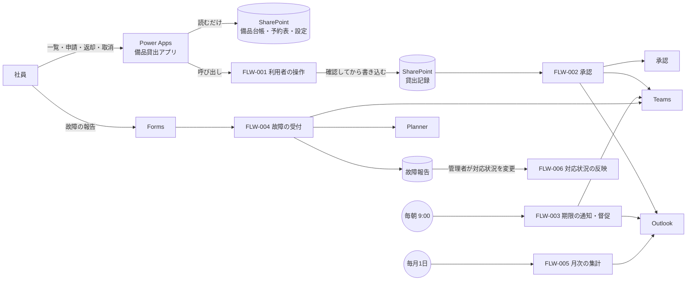

| 使う物 | 役割 |
|---|---|
| Power Apps（キャンバス アプリ） | 備品の一覧・申請・自分の貸出（3画面） |
| Power Automate（6本） | 申請の受付・承認・期限の通知と督促・故障の受付・月次の集計・故障の対応状況の反映 |
| SharePoint | リスト6つ（備品台帳・貸出記録・故障報告・設定・処理ログ・予約表）と月次レポートのライブラリ |
| 承認・Teams・Outlook・Forms・Planner | 承認依頼、チャンネルへの知らせ、メール、故障の受付、修理の対応タスク |

## 画面と動作の様子

架空のデータで、申請から承認・通知まで、故障の報告から対応タスクまでを、実際の Microsoft 365 の環境で通しで動かしたときの画面です（2026-11-18。氏名・管理用の ID は塗りつぶしています）。

**1. 社員が備品を選んで申請する（Power Apps）**

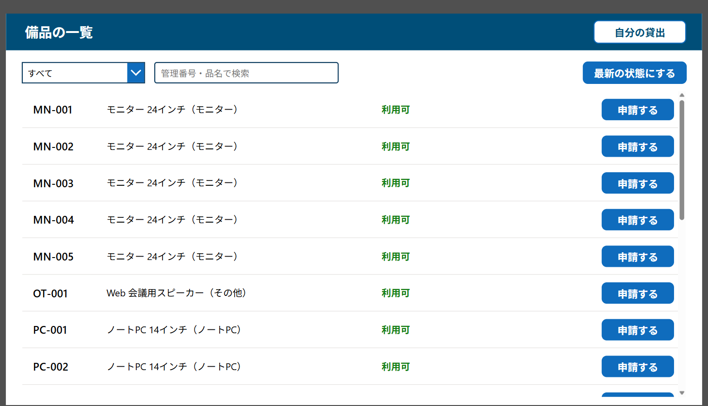

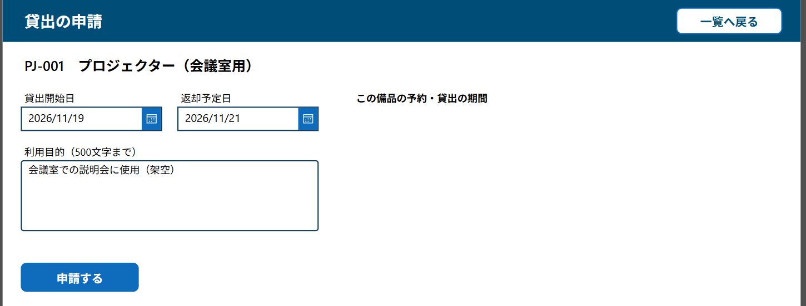

**2. 承認者に承認依頼が届く（承認）→ 承認すると Teams とメールで知らせる**

| 承認依頼 | Teams のチャンネル | 申請者へのメール |
|---|---|---|
| 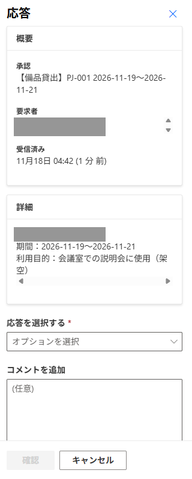 | 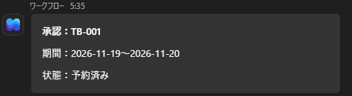 | 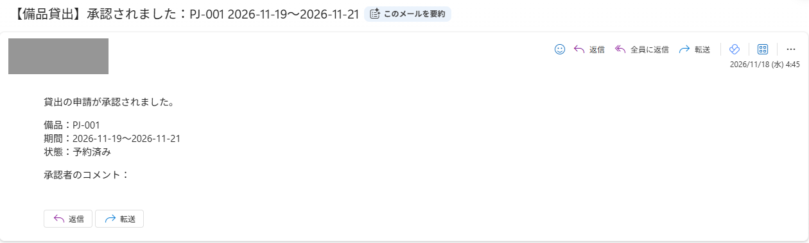 |

> Teams のカードは、最終監査の修正（チャンネルに氏名を載せない）の後に、別の申請（TB-001）で撮り直したものです。

**3. 社員の「自分の貸出」で予約済みになる**

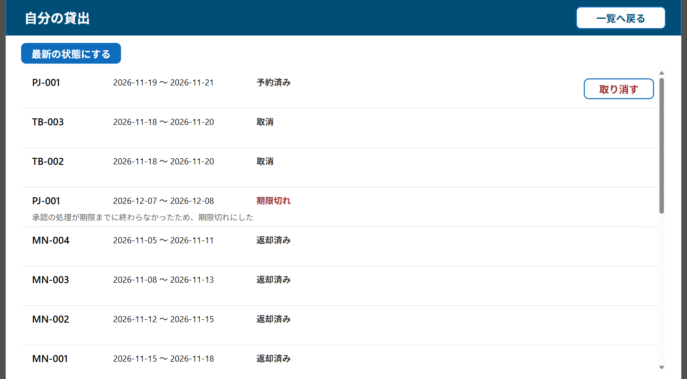

**4. 故障を Forms で報告すると、Planner に対応タスクができ、Teams に知らせる（内容と報告者はチャンネルに載せない）**

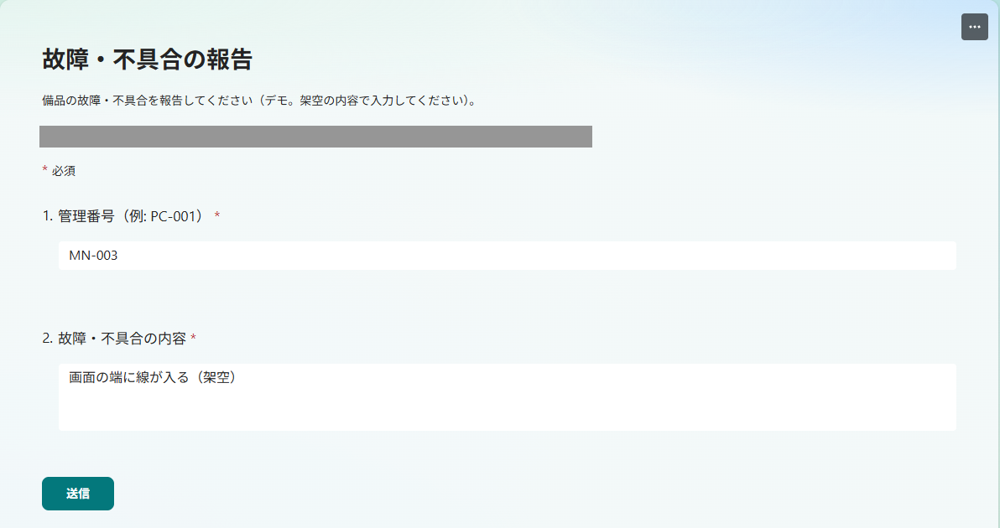

 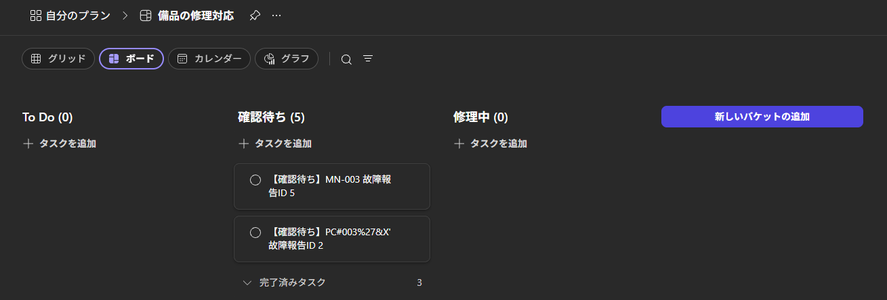

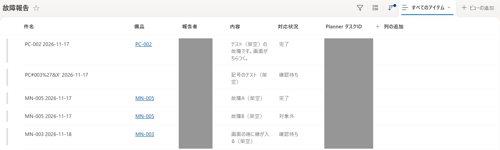

**5. フロー6本と実行の記録（Power Automate）**

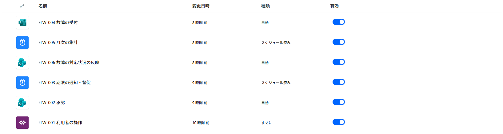

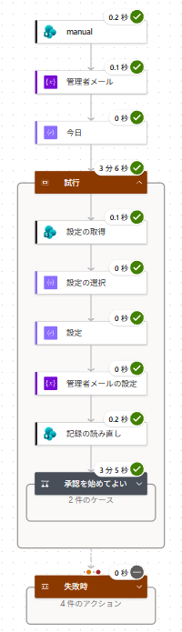

## 設計の要点

| 要点 | 内容 |
|---|---|
| 書き込みの入口を1つにする | 社員はリストを読むだけ。申請・返却・取消は FLW-001 が、呼び出した人・状態・期間を確かめてから書き込む。アプリから渡す「申請者」は使わず、フローが受け取る要求の情報から本人を確定する |
| 同時の申請でも二重に貸さない | 記録を「確認中」で作り、作った後にもう一度重なりを確かめ、先に作られた方を優先する |
| 状態の上書きを防ぐ | 状態の書き換えは、読んだときの ETag と一致する場合だけ行う（取消と承認が重なっても矛盾しない）（[ADR 0002](docs/adr/0002-SharePointはHTTPとETagで書く.md)） |
| 自己承認の防止 | 承認した人が申請者本人なら却下にする（設定で切り替え。このデモの環境だけ許可） |
| 注入を防ぐ | 要求の本文は文字列の連結ではなく式でオブジェクトとして組み立てる（[ADR 0004](docs/adr/0004-要求の本文は式で組み立てる.md)）。メール・Teams に入れる自由入力は無害化し、CSV は数式として動かないようにする |
| 個人情報を広げない | Teams のチャンネル（メンバー全員が読む）には、氏名・利用目的・故障の内容を載せない。氏名はメールにだけ載せる。実行の記録でも、氏名・メールアドレス・利用目的・コメントを含む手順は入力と出力を隠す（隠す設定を付けられない条件の分岐は除く。[詳細設計 2.4](docs/03_詳細設計.md)） |
| 修理の完了の入口 | Planner は誰でも完了にできるため、備品の状態は管理者だけが編集できる故障報告の対応状況から変える（[ADR 0003](docs/adr/0003-修理の完了は故障報告から.md)） |
| 止まった記録の後始末 | 承認の途中で止まった記録・作りかけの記録を、毎朝の処理で期限切れ・エラーにする |
| 失敗を残す | すべてのフローで、失敗したら処理ログに記録し、管理者にメールする（申請の本文・個人情報はログに入れない） |

## コードで作る

画面で1つずつ組み立てる代わりに、定義をコードで持ち、差分で査読できるようにしています（[ADR 0001](docs/adr/0001-パッケージで取り込む.md)）。

```text
tools/gen_flows.py          フロー6本の定義（flows/*.json）を生成する
tools/build_package.py      定義を「パッケージのインポート」用の zip にする（テナント固有の値は外部の設定ファイルで埋める）
tools/provision-lists.js    リスト・列・権限・初期データを作る（サイトを開いたブラウザで実行）
tools/seed-test-loans.js    FLW-003 のテスト用の記録を作る
tools/check_public_safety.py  公開してよいかの検査（コミット前・CI）
flows/                      生成したフローの定義
app/                        画面の定義（Power Apps Studio に貼り付ける YAML）
docs/                       設計書一式・ADR
```

## 導入方法

概要のみ記載します。詳しい手順は [導入・運用手順書](docs/06_導入・運用手順.md) を参照してください。

1. Teams のチーム・Planner のプラン・Forms のフォームを作る
2. チームのサイトで `tools/provision-lists.js` を実行し、リストと権限を作る
3. テナント固有の値（サイトの URL・各 ID）を `.gitignore` で除外した設定ファイルに書き、`tools/build_package.py` でフローの zip を作って取り込む
4. アプリを作り、`app/*.yaml` を各画面に貼り付けて公開する

## 確認していないこと

- **社内のユーザーが1人の環境で確認しています。** 申請者・承認者・管理者が同じ人のため、社員の権限で書き込めないこと、2人目の利用者がアプリからフローを使えることは確認していません。
- FLW-001 は呼び出した人を要求ヘッダー（`x-ms-user-email`）から取ります。利用者がこのヘッダーを書き換えて送れないことは確認していません。本番の前に確かめる手順を [権限設計 6章](docs/04_権限設計.md) に書いています。
- 承認の7日の期限切れ、同時の申請は、実際の環境では確認していません（[テスト仕様書 3 章](docs/05_テスト仕様書.md)）。
- アプリの一覧には委任の警告が7件あります。備品が数十件の前提で、件数の上限は確認していません。
- このテナントではソリューションの書き出し・取り込みが使えなかったため、フローとアプリはソリューションの外にあります。

## 設計書

| 文書 | 内容 |
|------|------|
| [01_要件定義](docs/01_要件定義.md) | 背景・課題・要件（REQ） |
| [02_基本設計](docs/02_基本設計.md) | 構成・方針・リスト・フロー一覧・画面・権限の概要 |
| [03_詳細設計](docs/03_詳細設計.md) | フローに共通する作り・FLW-001 の入力と応答・画面の数式 |
| [flows/](docs/flows/) | フローごとの全体図・ステップ一覧（`flows/*.json` から手元の設計書ツールで生成し、目的・接続・再実行を記入。定義を変えたら作り直す） |
| [04_権限設計](docs/04_権限設計.md) | ロール・権限表・書き込みの入口ごとの確認・残るリスク |
| [05_テスト仕様書](docs/05_テスト仕様書.md) | テストケース（TC）と実施結果・未実施の項目 |
| [06_導入・運用手順](docs/06_導入・運用手順.md) | 導入手順・日々の運用・設定の変え方・担当者の交代 |
| [07_障害対応手順書](docs/07_障害対応手順書.md) | 障害時の流れ・記録の食い違いの直し方・症状別の対応 |
| [ADR](docs/adr/) | 0001 パッケージで取り込む／0002 HTTP と ETag／0003 修理の完了の入口／0004 要求の本文の組み立て |
| [CHANGELOG](CHANGELOG.md) | 変更履歴 |
