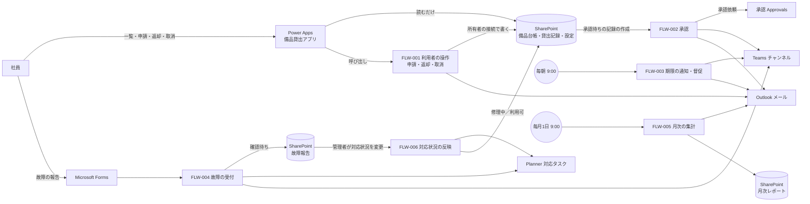
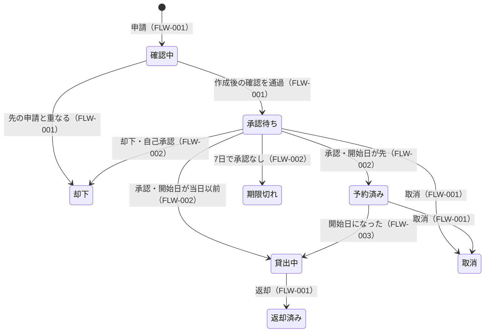

# 基本設計書

## 文書情報

| 項目 | 内容 |
|------|------|
| 文書名 | 基本設計書（備品・PC の貸出管理） |
| 版 | 0.4 |
| 作成日 | 2026-11-17 |

## 改版履歴

| 版 | 日付 | 内容 |
|----|------|------|
| 0.1 | 2026-11-17 | 初版（実装前の骨子） |
| 0.2 | 2026-11-17 | 構成の査読を反映。書き込みをフロー経由に限定、予約の受け付け、承認の分離と期限、重なりの判定の見直し、修理完了・取消の処理を追加、リストの作成をスクリプト化 |
| 0.3 | 2026-11-17 | セキュリティ監査・Codex の指摘を反映。閲覧の範囲を予約表に限定、確認中の状態と ETag による状態の照合、引数の検証、自己承認の設定、故障の確認待ち、修理完了の操作者の確認、通知と CSV の無害化、公開前の秘匿値の検査（9章） |
| 0.4 | 2026-11-18 | 実装に合わせて改訂。ソリューションをやめてパッケージで取り込む方式に変更、呼び出したユーザーの特定方法、承認の期限を固定、FLW-003 に止まった記録の後始末を追加、FLW-006 の入口を故障報告の対応状況の変更に変更、取消時に承認依頼は取り消さない（結果を書かない）ことを明記 |

## 1. 全体構成

| 構成要素 | 使う物 | ライセンス上の扱い |
|---|---|---|
| 画面 | Power Apps キャンバス アプリ | Microsoft 365 に含まれる Power Apps（標準コネクタだけ） |
| データ | SharePoint のリスト・ドキュメント ライブラリ | Microsoft 365 に含まれる |
| 処理 | Power Automate のクラウド フロー（6本） | Microsoft 365 に含まれる Power Automate（標準コネクタだけ） |
| 承認 | Standard approvals | 標準コネクタ |
| 通知 | Teams・Office 365 Outlook | 標準コネクタ |
| 故障の受付 | Microsoft Forms・Planner（基本のプラン） | 標準コネクタ |

- Teams のチーム「備品貸出管理（デモ）」を1つ作り、そのチームの SharePoint サイト・Planner のプラン・チャンネルを使う。権限はチーム（Microsoft 365 グループ）の所有者・メンバーでまとめて管理する。
- フロー・アプリは既定の環境に、**ソリューションに入れずに**置く。デモのテナントではソリューションの書き出し・取り込みが使えなかったため（`Async operations are currently disabled`）、フローは定義（`flows/*.json`）を `tools/build_package.py` でパッケージ（zip）にし、「パッケージのインポート（レガシ）」で取り込む（[ADR-0001](adr/0001-パッケージで取り込む.md)）。
- サイトの URL・リスト・チーム・チャンネル・プラン・フォームの ID は、定義の中では `{{SITE_URL}}` などの置き場所にしておき、パッケージを作るときにリポジトリの外の設定ファイル（`private/config.local.json`）の値で埋める。別の環境では設定ファイルを差し替えるだけにする（REQ-102）。接続は、取り込みの画面で既にある接続を選んで結び付ける。
- SharePoint のリストは、リストと列は `tools/provision-lists.js`（SharePoint の REST API を、サイトを開いたブラウザで実行するスクリプト）で作る。手で列を足す作業をなくし、別の環境でも同じリストを作れるようにする。

## 2. 基本の方針

| 方針 | 理由 |
|---|---|
| **社員はリストを読むだけ。書き込みは FLW-001（Power Apps から呼ぶフロー）が所有者の接続で行う** | 社員がリストを直接編集できると、状態・期間・承認者を書き換えて承認を通らない貸出を作れる（項目単位の編集制限では、列ごとの制限ができない）。書き込みの入口を1つにし、必ず確認を通す |
| **操作した人は、フローが受け取る要求の情報（呼び出したユーザー）で判定する。アプリから渡す値は使わない** | アプリから渡す「申請者」の値は、書き換えて他人になりすませる。実装では、トリガーの要求ヘッダー `x-ms-user-email` を SharePoint のユーザーとして確定し（ensureuser）、確定したユーザーのメールか UPN が一致するときだけ進め、以後は SharePoint のユーザー ID（整数）で本人を判定する。ヘッダーを利用者が書き換えられないことは確かめていない（残るリスクとして 04 権限設計に記載） |
| **社員が読めるのは備品台帳と予約表（備品・期間・状態だけ）。本人の記録は FLW-001 の「一覧」の操作で本人の分だけ返す** | 貸出記録には利用目的・承認コメントが入る。記録を作るのは所有者の接続なので、リストの「自分が作成したアイテムだけ読める」設定は効かない |
| **状態の書き換えは、読んだときの ETag と一致する場合だけ行う（SharePoint の REST の If-Match）** | 確認した後に別のフロー・操作が状態を変えていた場合に、上書きしない。取消と承認、承認と期限切れが重なっても矛盾しない |
| **アプリから受け取る値は、ID は整数、操作の種類は決まった値と照合してから使う。検索の条件に文字列のまま連結しない** | 条件を書き換えて重なりの判定を空にする注入を防ぐ |
| **自己承認は既定で拒否する。設定「自己承認を許可」で切り替える** | 申請者が自分で承認できると、承認の意味がなくなる。デモの環境はユーザーが1人のため、デモだけ許可し、文書に明記する |
| **予約を受け付ける。備品台帳の状態は「利用可／修理中／廃棄」だけにし、貸出中かどうかは貸出記録から判断する** | 開始日が先の予約を受け付けると、台帳に「貸出中」を持たせると実態と食い違う。予約と貸出中は貸出記録の状態で表す |
| **重なりの判定は「承認待ち・予約済み・貸出中」の記録を対象にし、記録は「確認中」で作り、作った後にもう一度確かめてから「承認待ち」にする** | 同時に申請された2件が、どちらも先に作られた記録を見落とす競合を防ぐ。作成後に、自分より ID が小さい重なる記録があれば、自分を却下する（先に作られた方を優先する）。承認依頼は「承認待ち」になってから出すので、取り下げる申請に承認依頼が出ない |
| **承認を待つフロー（FLW-002）は、申請を受け付けるフローと分ける。承認の期限は7日（フローの定義に固定）** | 同時実行の制限を付けたフローで承認を待つと、承認待ちの間ほかの申請がすべて止まる。フローの実行は最長30日で打ち切られる。承認の手順の期限は式で変えられないため、定義に7日（P7D）で固定し、設定「承認期限日数」は既定値の 7 のまま使う（変える場合は定義も直す） |

## 3. SharePoint のリスト

### 3.1 備品台帳（LST-001）

| 列名 | 種類 | 必須 | 内容 |
|---|---|---|---|
| 管理番号（Title） | 1行テキスト | ○ | 例: PC-001。一意の値を必須にする |
| 品名 | 1行テキスト | ○ | 例: ノートPC 14インチ |
| 区分 | 選択肢 | ○ | ノートPC／モニター／プロジェクター／タブレット／その他 |
| 状態 | 選択肢 | ○ | 利用可／修理中／廃棄。既定値は利用可 |
| 保管場所 | 1行テキスト | | 例: 本社3F 総務部キャビネット |
| 備考 | 複数行テキスト | | |

### 3.2 貸出記録（LST-002）

| 列名 | 種類 | 必須 | 内容 |
|---|---|---|---|
| 件名（Title） | 1行テキスト | ○ | FLW-001 が「管理番号 開始日〜返却予定日」で入れる |
| 備品 | 参照（備品台帳の管理番号） | ○ | |
| 申請者 | ユーザー | ○ | FLW-001 が呼び出したユーザーを入れる |
| 利用目的 | 複数行テキスト | ○ | |
| 貸出開始日 | 日付 | ○ | |
| 返却予定日 | 日付 | ○ | |
| 状態 | 選択肢 | ○ | 確認中／承認待ち／予約済み／貸出中／返却済み／却下／取消／期限切れ／エラー |
| 承認者 | ユーザー | | FLW-002 が入れる |
| 承認コメント | 複数行テキスト | | FLW-002 が入れる |
| 承認日時 | 日付と時刻 | | FLW-002 が入れる |
| 承認開始日時 | 日付と時刻 | | FLW-002 が承認依頼を出す前に入れる（二重の承認依頼を防ぐ） |
| 返却日 | 日付 | | FLW-001 が返却時に入れる |
| 督促回数 | 数値 | | 既定値 0。FLW-003 が入れる |
| 最終通知日 | 日付 | | 同じ日の二重送信を防ぐ。FLW-003 が入れる |
| 処理メモ | 複数行テキスト | | 受け付けなかった理由・エラーの内容 |

状態の移り変わり:

### 3.3 故障報告（LST-003）

所有者だけが読める。

| 列名 | 種類 | 内容 |
|---|---|---|
| 件名（Title） | 1行テキスト | 管理番号と報告日 |
| 備品 | 参照（備品台帳） | Forms で入力された管理番号から引く。見つからなければ空 |
| 報告者 | ユーザー | Forms の回答者（組織内の人だけ回答でき、名前を記録する設定にする。要検証） |
| 内容 | 複数行テキスト | |
| 対応状況 | 選択肢 | 確認待ち／修理中／完了／対象外 |
| Planner タスクID | 1行テキスト | 作成したタスクとの対応 |

### 3.4 設定（LST-004）

社員も読める（アプリが上限日数を使うため）。秘密の値は置かない。

| 項目（Title） | 値の例 | 内容 |
|---|---|---|
| 承認者メール | （アドレス） | 承認依頼の宛先 |
| 管理者メール | （アドレス） | エラー・督促の上限到達・月次の集計の宛先 |
| 貸出上限日数 | 14 | これを超える期間の申請は受け付けない |
| 予約受付日数 | 60 | 開始日をこれより先にする申請は受け付けない |
| 督促上限回数 | 5 | 達したら管理者に知らせ、それ以上は督促しない |
| 承認期限日数 | 7 | 過ぎたら期限切れにする（フローの定義に 7日で固定。値を変えるときは定義も直す） |
| 自己承認を許可 | いいえ | 「はい」のときだけ、申請者本人の承認を受け付ける（デモの環境だけ「はい」） |

### 3.5 処理ログ（LST-005）

所有者だけが読める。保存期間は1年（運用手順で古い行を消す）。

| 列名 | 種類 | 内容 |
|---|---|---|
| 件名（Title） | 1行テキスト | フロー名 |
| 対象 | 1行テキスト | 対象のリストとアイテムの ID |
| 結果 | 選択肢 | 成功／受け付けず／失敗 |
| 詳細 | 複数行テキスト | 失敗した手順と理由（申請の本文・個人情報は入れない） |
| 実行の記録 | ハイパーリンク | フローの実行履歴へのリンク |

### 3.6 予約表（LST-006）

社員が読める。FLW-001・FLW-002・FLW-003 が、貸出記録の状態が変わるたびに同じ内容を書く。

| 列名 | 種類 | 内容 |
|---|---|---|
| 件名（Title） | 1行テキスト | 貸出記録の ID |
| 備品 | 参照（備品台帳） | |
| 貸出開始日・返却予定日 | 日付 | |
| 状態 | 選択肢 | 確認中／承認待ち／予約済み／貸出中（終わった記録は消す） |

### 3.7 ドキュメント ライブラリ

- 月次レポート（LIB-001）: FLW-005 が CSV（UTF-8・先頭に BOM）を保存する。所有者だけが読める。明細に自由入力と氏名は入れない（管理番号・期間・状態・延滞日数だけ）。

## 4. フロー

共通の作り:
- 処理全体を「試行」のスコープに入れ、失敗時は「失敗時」のスコープで処理ログに記録し、管理者にメールする（REQ-103）。
- 設定値は毎回 設定（LST-004）から読む（REQ-011）。
- 日付の「今日・翌日・前月」は、日本時間に変換してから計算する。
- メール・Teams に入れる自由入力の文（利用目的・コメント・故障の内容）は、HTML の特殊文字を無害化し、200文字で切り、URL の「://」を崩す。Teams のカードは文字列の連結ではなく、部品（オブジェクト）として組み立てる。
- 状態を書き換えるときは「SharePoint に HTTP 要求を送信します」で If-Match に ETag を付ける。一致しなければ書き換えず、処理ログに残す。

| ID | 名前 | トリガー | 主な処理 |
|---|---|---|---|
| FLW-001 | 利用者の操作 | Power Apps から呼ぶ（引数: 操作の種類＝申請／返却／取消／一覧、備品の ID、期間、目的、対象の記録の ID） | 引数を検証する（ID は整数、操作の種類は4つの値のどれか、目的は500文字まで）。呼び出したユーザーを、要求の情報（`x-ms-user-email`）から SharePoint のユーザー ID に確定する。**一覧**: 本人の記録だけを返す。**申請**: 備品が利用可か、期間の上限・予約受付日数・前後関係、確認中・承認待ち・予約済み・貸出中の記録との重なりを確かめ、通れば 状態＝確認中で記録を作る。作成後にもう一度重なりを確かめ、自分より ID が小さい重なる記録があれば自分を却下にし、なければ承認待ちにする。予約表にも書く。**返却**: 対象が本人の貸出中の記録か確かめ、返却日を入れて返却済みにする。**取消**: 対象が本人の承認待ち・予約済み（開始前）の記録か確かめ、ETag の照合つきで取消にする。出ている承認依頼は取り消さず、後で応答があっても FLW-002 が状態を確かめて結果を書かない。結果をアプリに返す |
| FLW-002 | 承認 | 貸出記録のアイテムが変更されたとき（状態＝承認待ち、かつ承認開始日時が空に限る。書き込めるのは所有者の接続だけ） | 承認開始日時を ETag の照合つきで入れてから、承認を開始して待つ（期限は承認期限日数）。応答した人が申請者本人で、自己承認を許可が「いいえ」なら却下にする。承認なら、開始日が当日以前は貸出中・先なら予約済みにし、申請者にメール、Teams に投稿。却下なら却下にし、申請者にメール。期限を過ぎたら期限切れにし、申請者にメール。承認の結果を記録する前に、記録がまだ承認待ちか確かめる（取消された後に上書きしない） |
| FLW-003 | 期限の通知・督促 | 毎朝 9:00（日本時間） | 予約済みで開始日が今日以前 → 貸出中にする。貸出中で返却予定日が翌日 → 申請者にお知らせのメール。返却予定日を過ぎた → 督促のメール、督促回数を1増やす。上限に達したら管理者にメールと Teams。最終通知日で同じ日の二重送信を防ぐ。**止まった記録の後始末**: 承認を始めてから8日過ぎた承認待ち、承認を始めないまま1日過ぎた承認待ちを期限切れにし、確認中のまま1時間過ぎた記録をエラーにする（予約表もそろえる）。4つの処理は独立した範囲で動かし、1つが失敗しても残りは動かす |
| FLW-004 | 故障の受付 | Forms「故障・不具合の報告」に回答が送信されたとき（チームのフォームは ID を手で指定する。組織内の人だけ回答でき、名前を記録する設定） | 故障報告に 対応状況＝確認待ちで登録し、Planner に確認のタスクを作り、Teams に投稿する。**備品台帳は自動で変えない**（いたずらで貸出を止められないように）。管理者が確かめてから、備品台帳を修理中にする |
| FLW-005 | 月次の集計 | 毎月1日 9:00（日本時間） | 前月の貸出件数・延滞の件数・故障の件数を集計し、明細の CSV を月次レポートに保存。管理者にメールする |
| FLW-006 | 故障の対応状況の反映 | 故障報告の対応状況が 修理中／完了／対象外 に変わったとき（故障報告を編集できるのは所有者だけ） | Planner のタスクを対応状況に合わせる（修理中→進行中、完了・対象外→完了）。備品の状態は、その備品に「修理中」の故障報告が残っているかで決める（1件以上→修理中、0件→利用可。廃棄は変えない）。何度動いても同じ結果になる。入口を Planner の完了にしなかった理由は [ADR-0003](adr/0003-修理の完了は故障報告から.md) |

- 90日間一度も動かないフローは止められることがある（FLW-004・FLW-006 が該当しうる）。運用手順で、止まっていないかを毎月確かめる。

## 5. 画面（Power Apps）

| ID | 画面 | 内容 |
|---|---|---|
| SCR-001 | 備品の一覧 | 区分・状態で絞り込み、管理番号・品名で検索。選んだ備品の今後の予約（予約表の期間だけ）を表示する（REQ-001） |
| SCR-002 | 貸出の申請 | 利用目的・開始日・返却予定日を入れて FLW-001 を呼ぶ。上限日数と前後関係はその場でも確かめ、最終の判定は FLW-001 の結果を表示する（REQ-002・003） |
| SCR-003 | 自分の貸出 | FLW-001 の「一覧」で受け取った本人の記録と状態。貸出中は「返却した」、承認待ち・予約済みは「取り消す」を押すと FLW-001 を呼ぶ（REQ-007） |

## 6. 権限（概要）

| 対象 | 所有者（総務部の管理者） | メンバー（社員） |
|---|---|---|
| 備品台帳・予約表・設定 | 編集 | 閲覧 |
| 貸出記録・故障報告・処理ログ・月次レポート | 編集 | なし |
| フロー | 所有者（共同所有者を1人以上置く） | FLW-001 はアプリ経由で実行だけ（所有者の接続を使う設定。要検証） |
| アプリ | 共同所有者 | 利用者として共有 |

- チームサイトのメンバーは既定で編集できる（要検証）ため、`tools/provision-lists.js` で各リスト・ライブラリの権限の継承を切り、上の表のとおりに付け直す。付け直した権限（所有者＝フル コントロール、メンバー＝閲覧）は、スクリプトが読み直して確かめる。メンバーの権限で書き込みが失敗することは、デモの環境に社内のユーザーが1人しかいないため確かめていない（05 テスト仕様書の未実施の項目）。
- Planner のタスクはチームのメンバーなら誰でも完了にできるため、備品の状態を戻す入口は Planner ではなく、所有者だけが編集できる故障報告の対応状況にした（FLW-006）。Planner のタスクは結果を写すだけ。
- デモの環境ではユーザーが1人のため、所有者とメンバーの分離は外部アカウントでの閲覧の可否まで確かめ、確かめられない点は文書に明記する。

## 7. 実装の順序（実績）

1. チームを作り、リストと権限を作る（`tools/provision-lists.js`）。架空の備品20件・設定7件を入れる
2. FLW-001 を作り、なりすまし・注入を含む7件を確かめる
3. FLW-002（承認・却下・自己承認の拒否）、FLW-003（テスト用の記録 A〜F）、FLW-004〜006 の順に作り、確かめる
4. アプリの3画面を YAML で作り、貼り付けて組み立て、プレビューで確かめる
5. 公開したアプリで通しの確認を行い、画面を撮影する

## 8. 確かめ方

- 架空の備品20件・架空の申請で、実際の Microsoft 365 の環境でフローを動かし、結果（リスト・メール・Teams・Planner・CSV）を画面で確かめて撮影する。
- テスト仕様書（05）に、テストケースごとの手順・期待結果・実施結果を残す。確かめられなかった点も同じ表に「未実施」と理由を書く。

## 9. 公開するリポジトリと画像の扱い

- サイトの URL・各 ID は定義に置き場所（`{{KEY}}`）で書き、値はリポジトリの外の設定ファイルに置く。
- コミットの前に `tools/check_public_safety.py --staged` で、sharepoint.com・onmicrosoft・GUID・メールアドレス（URL エンコード・\u エスケープ・HTML 実体参照の形を含む）を検査する。CI でも同じ検査を行う。Base64 にした値と、ドメインを伴わないテナント名だけの文字列は検出できない。
- スクリーンショットは、アドレス欄・アカウント名・テナント名・メールアドレスを塗りつぶしてから載せ、塗りつぶした後の画像を目で確かめる。
