# FLW-001 利用者の操作 フロー設計書

## 文書情報

| 項目 | 内容 |
|---|---|
| 文書ID | DD-FLW-001 |
| システム名 | 備品・PC の貸出管理 |
| 版 | 0.1 |
| 作成日 | 2026-11-18 |
| 状態 | 確定 |

## 改版履歴

| 版 | 日付 | 変更内容 | 変更者 |
|---|---|---|---|
| 0.2 | 2026-11-18 | `flows/FLW-001.json` から flow_to_md.py で生成し、概要・接続・エラー処理を記入（最終監査の修正を反映） | — |

## 1. 概要

| 項目 | 内容 |
|---|---|
| フロー名 | FLW-001 利用者の操作 |
| 基盤 | Power Automate |
| 目的 | Power Apps から呼ばれ、申請・一覧・返却・取消を、確認してから所有者の接続で書き込む |
| 関連要件 | REQ-002、REQ-003、REQ-007、REQ-104 |
| トリガー | Power Apps から呼ぶ（引数: 操作の種類・備品 ID・開始日・返却予定日・目的・記録 ID） |
| 同時実行 | 同時の申請は、記録を「確認中」で作った後の再確認で、ID が小さい方を優先して解決する（基本設計 2章） |
| 想定件数 | 1回 1件。1日 数十回 |
| ステップ数 | 86 |

## 2. 全体図

```mermaid
flowchart TD
    n1(["manual"])
    n2["結果"]
    n3["メッセージ"]
    n4["データ"]
    n5["利用者ID"]
    n6["新しい記録ID"]
    n7["管理者メール"]
    n8["呼び出し元"]
    n9["今日"]
    n10["試行"]
    subgraph gn10["試行 の中"]
        n11["設定の取得"]
        n12["設定の選択"]
        n13["設定"]
        n14["管理者メールの設定"]
        n15{"呼び出し元あり"}
        subgraph gn15["呼び出し元あり の中"]
            n16["利用者の確認"]
            n17{"利用者の一致"}
            subgraph gn17["利用者の一致 の中"]
                n18["利用者IDの設定"]
                n19{"操作"}
                subgraph gn19["操作 の中"]
                    n20["入力"]
                    n21["入力の検査"]
                    n22{"入力が正しい"}
                    subgraph gn22["入力が正しい の中"]
                        n23["期間"]
                        n24["備品の取得"]
                        n25["重なりの取得"]
                        n26{"受付できる"}
                        subgraph gn26["受付できる の中"]
                            n27["記録の作成"]
                            n28["記録IDの保持"]
                            n29["先の重なりの取得"]
                            n30{"先の申請なし"}
                            subgraph gn30["先の申請なし の中"]
                                n31["予約表に追加"]
                                n32["承認待ちにする"]
                                n33["受付の結果"]
                                n34["受付のメッセージ"]
                                n35["先の申請に譲る"]
                                n36["競合の結果"]
                                n37["競合のメッセージ"]
                            end
                            n38["不可の結果"]
                            n39["不可のメッセージ"]
                        end
                        n40["入力の誤りの結果"]
                        n41["入力の誤りのメッセージ"]
                    end
                    n42["自分の記録"]
                    n43["一覧の整形"]
                    n44["一覧のデータ"]
                    n45["一覧の結果"]
                    n46["返却の対象"]
                    n47{"返却できる"}
                    subgraph gn47["返却できる の中"]
                        n48["返却にする"]
                        n49["返却の予約表"]
                        n50[["返却の予約表から消す"]]
                        subgraph gn50["返却の予約表から消す の中"]
                            n51["返却の予約の削除"]
                        end
                        n52["返却の結果"]
                        n53["返却のメッセージ"]
                        n54["返却不可の結果"]
                        n55["返却不可のメッセージ"]
                    end
                    n56["取消の対象"]
                    n57{"取消できる"}
                    subgraph gn57["取消できる の中"]
                        n58["取消にする"]
                        n59["取消の予約表"]
                        n60[["取消の予約表から消す"]]
                        subgraph gn60["取消の予約表から消す の中"]
                            n61["取消の予約の削除"]
                        end
                        n62["取消の結果"]
                        n63["取消のメッセージ"]
                        n64["取消不可の結果"]
                        n65["取消不可のメッセージ"]
                    end
                    n66["不明な操作の結果"]
                    n67["不明な操作のメッセージ"]
                end
                n68["利用者不一致の結果"]
                n69["利用者不一致のメッセージ"]
            end
            n70["呼び出し元なしの結果"]
            n71["呼び出し元なしのメッセージ"]
        end
    end
    n72["失敗時"]
    subgraph gn72["失敗時 の中"]
        n73["失敗した手順"]
        n74["失敗の要約"]
        n75{"作りかけの記録あり"}
        subgraph gn75["作りかけの記録あり の中"]
            n76["作りかけの読み直し"]
            n77{"まだ確認中"}
            subgraph gn77["まだ確認中 の中"]
                n78["作りかけをエラーにする"]
                n79["作りかけの予約表"]
                n80[["作りかけの予約表から消す"]]
                subgraph gn80["作りかけの予約表から消す の中"]
                    n81["作りかけの予約の削除"]
                end
            end
        end
        n82["処理ログに記録"]
        n83{"管理者に知らせる"}
        subgraph gn83["管理者に知らせる の中"]
            n84["管理者へのメール"]
        end
        n85["失敗の結果"]
        n86["失敗のメッセージ"]
    end
    n87["アプリへの応答"]
    n1 --> n2
    n2 --> n3
    n3 --> n4
    n4 --> n5
    n5 --> n6
    n6 --> n7
    n7 --> n8
    n8 --> n9
    n9 --> n10
    n10 --> n11
    n11 --> n12
    n12 --> n13
    n13 --> n14
    n14 --> n15
    n16 --> n17
    n18 --> n19
    n20 --> n21
    n21 --> n22
    n23 --> n24
    n24 --> n25
    n25 --> n26
    n27 --> n28
    n28 --> n29
    n29 --> n30
    n31 --> n32
    n32 --> n33
    n33 --> n34
    n35 --> n36
    n36 --> n37
    n30 -->|"はい"| n31
    n30 -->|"いいえ"| n35
    n38 --> n39
    n26 -->|"はい"| n27
    n26 -->|"いいえ"| n38
    n40 --> n41
    n22 -->|"はい"| n23
    n22 -->|"いいえ"| n40
    n19 -->|"申請"| n20
    n42 --> n43
    n43 --> n44
    n44 --> n45
    n19 -->|"一覧"| n42
    n46 --> n47
    n48 --> n49
    n49 --> n50
    n50 --> n51
    gn50 --> n52
    n52 --> n53
    n54 --> n55
    n47 -->|"はい"| n48
    n47 -->|"いいえ"| n54
    n19 -->|"返却"| n46
    n56 --> n57
    n58 --> n59
    n59 --> n60
    n60 --> n61
    gn60 --> n62
    n62 --> n63
    n64 --> n65
    n57 -->|"はい"| n58
    n57 -->|"いいえ"| n64
    n19 -->|"取消"| n56
    n66 --> n67
    n19 -->|"既定"| n66
    n68 --> n69
    n17 -->|"はい"| n18
    n17 -->|"いいえ"| n68
    n70 --> n71
    n15 -->|"はい"| n16
    n15 -->|"いいえ"| n70
    gn10 -->|"失敗・タイムアウト"| n72
    n72 --> n73
    n73 --> n74
    n74 -->|"成功・失敗・スキップ・タイムアウト"| n75
    n76 --> n77
    n78 --> n79
    n79 --> n80
    n80 --> n81
    n77 -->|"はい"| n78
    n75 -->|"はい"| n76
    gn75 -->|"成功・失敗・スキップ・タイムアウト"| n82
    n82 -->|"成功・失敗・スキップ・タイムアウト"| n83
    n83 -->|"はい"| n84
    gn83 -->|"成功・失敗・スキップ・タイムアウト"| n85
    n85 --> n86
    gn72 -->|"成功・失敗・スキップ・タイムアウト"| n87
```

## 3. トリガー

| No | 名前 | 種類 | 設定 | 条件・備考 |
|---|---|---|---|---|
| T1 | manual（生成のツールが全フローで同じ名前を付ける） | Request | schema={"type":"object","properties":{"text":{"title":"operation","type":"string","description":"申請／一覧／返却／取消","x-ms-con… |  |

## 4. ステップ一覧

| No | ステップ名 | 種類 | 前のステップ（実行条件） | 主な設定 | エラー時 | 備考 |
|---|---|---|---|---|---|---|
| 1 | 結果 | InitializeVariable |  | variables=[{"name":"結果","type":"string","value":"エラー"}] |  |  |
| 2 | メッセージ | InitializeVariable | 結果 | variables=[{"name":"メッセージ","type":"string","value":""}] |  |  |
| 3 | データ | InitializeVariable | メッセージ | variables=[{"name":"データ","type":"string","value":"[]"}] |  |  |
| 4 | 利用者ID | InitializeVariable | データ | variables=[{"name":"利用者ID","type":"integer","value":0}] |  |  |
| 5 | 新しい記録ID | InitializeVariable | 利用者ID | variables=[{"name":"新しい記録ID","type":"integer","value":0}] |  |  |
| 6 | 管理者メール | InitializeVariable | 新しい記録ID | variables=[{"name":"管理者メール","type":"string","value":""}] |  |  |
| 7 | 呼び出し元 | Compose | 管理者メール | @toLower(coalesce(triggerOutputs()?['headers']?['x-ms-user-email'], '')) |  |  |
| 8 | 今日 | Compose | 呼び出し元 | @formatDateTime(convertFromUtc(utcNow(), 'Tokyo Standard Time'), 'yyyy-MM-dd') |  |  |
| 9 | 試行 | Scope | 今日 |  |  |  |
| 9.1 | 　設定の取得 | OpenApiConnection |  | 操作: HttpRequest、dataset={{SITE_URL}}, parameters/method=GET, parameters/uri=_api/web/lists/getbytitle('設定')/items?$select=Title,Setting… |  |  |
| 9.2 | 　設定の選択 | Select | 設定の取得 | from=@body('設定の取得')?['value'], select=@substring(string(setProperty(json('{}'), coalesce(item()?['Title'], ''), coalesc… |  |  |
| 9.3 | 　設定 | Compose | 設定の選択 | @json(concat('{', join(body('設定の選択'), ','), '}')) |  |  |
| 9.4 | 　管理者メールの設定 | SetVariable | 設定 | name=管理者メール, value=@{coalesce(outputs('設定')?['管理者メール'], '')} |  |  |
| 9.5 | 　呼び出し元あり | If | 管理者メールの設定 | 条件: {"not":{"equals":["@outputs('呼び出し元')",""]}} |  |  |
| 9.5.Y | 　　【はい の場合】 |  |  |  |  |  |
| 9.5.Y.1 | 　　　利用者の確認 | OpenApiConnection |  | 操作: HttpRequest、dataset={{SITE_URL}}, parameters/method=POST, parameters/uri=_api/web/ensureuser, parameters/headers={"Accept":"applica… |  |  |
| 9.5.Y.2 | 　　　利用者の一致 | If | 利用者の確認 | 条件: {"or":[{"equals":["@toLower(coalesce(body('利用者の確認')?['Email'], ''))","@outputs('呼び出し元')"]},{"equals":["@toLower(coalesc… |  |  |
| 9.5.Y.2.Y | 　　　　【はい の場合】 |  |  |  |  |  |
| 9.5.Y.2.Y.1 | 　　　　　利用者IDの設定 | SetVariable |  | name=利用者ID, value=@int(body('利用者の確認')?['Id']) |  |  |
| 9.5.Y.2.Y.2 | 　　　　　操作 | Switch | 利用者IDの設定 | 値: @triggerBody()?['text'] |  |  |
| 9.5.Y.2.Y.2.1 | 　　　　　　【ケース 申請：申請】 |  |  |  |  |  |
| 9.5.Y.2.Y.2.1.1 | 　　　　　　　入力 | Compose |  | equipmentId=@int(coalesce(triggerBody()?['number'], 0)), start=@{trim(coalesce(triggerBody()?['text_1'], ''))}, due=@{t… |  |  |
| 9.5.Y.2.Y.2.1.2 | 　　　　　　　入力の検査 | Compose | 入力 | @and(greater(outputs('入力')?['equipmentId'], 0), equals(formatDateTime(outputs('入力')?['start'], 'yyyy-MM-dd'), outputs('… |  |  |
| 9.5.Y.2.Y.2.1.3 | 　　　　　　　入力が正しい | If | 入力の検査 | 条件: {"equals":["@outputs('入力の検査')",true]} |  |  |
| 9.5.Y.2.Y.2.1.3.Y | 　　　　　　　　【はい の場合】 |  |  |  |  |  |
| 9.5.Y.2.Y.2.1.3.Y.1 | 　　　　　　　　　期間 | Compose |  | start=@convertToUtc(concat(outputs('入力')?['start'], 'T00:00:00'), 'Tokyo Standard Time', 'yyyy-MM-ddTHH:mm:ssZ'), due=@… |  |  |
| 9.5.Y.2.Y.2.1.3.Y.2 | 　　　　　　　　　備品の取得 | OpenApiConnection | 期間 | 操作: HttpRequest、dataset={{SITE_URL}}, parameters/method=GET, parameters/uri=_api/web/lists/getbytitle('備品台帳')/items?$select=Id,Title,Eq… |  |  |
| 9.5.Y.2.Y.2.1.3.Y.3 | 　　　　　　　　　重なりの取得 | OpenApiConnection | 備品の取得 | 操作: HttpRequest、dataset={{SITE_URL}}, parameters/method=GET, parameters/uri=_api/web/lists/getbytitle('貸出記録')/items?$select=Id&$top=50&… |  |  |
| 9.5.Y.2.Y.2.1.3.Y.4 | 　　　　　　　　　受付できる | If | 重なりの取得 | 条件: {"and":[{"equals":["@length(body('備品の取得')?['value'])",1]},{"equals":["@length(body('重なりの取得')?['value'])",0]}]} |  |  |
| 9.5.Y.2.Y.2.1.3.Y.4.Y | 　　　　　　　　　　【はい の場合】 |  |  |  |  |  |
| 9.5.Y.2.Y.2.1.3.Y.4.Y.1 | 　　　　　　　　　　　記録の作成 | OpenApiConnection |  | 操作: HttpRequest、dataset={{SITE_URL}}, parameters/method=POST, parameters/uri=_api/web/lists/getbytitle('貸出記録')/items, parameters/header… |  |  |
| 9.5.Y.2.Y.2.1.3.Y.4.Y.2 | 　　　　　　　　　　　記録IDの保持 | SetVariable | 記録の作成 | name=新しい記録ID, value=@body('記録の作成')?['Id'] |  |  |
| 9.5.Y.2.Y.2.1.3.Y.4.Y.3 | 　　　　　　　　　　　先の重なりの取得 | OpenApiConnection | 記録IDの保持 | 操作: HttpRequest、dataset={{SITE_URL}}, parameters/method=GET, parameters/uri=_api/web/lists/getbytitle('貸出記録')/items?$select=Id&$top=50&… |  |  |
| 9.5.Y.2.Y.2.1.3.Y.4.Y.4 | 　　　　　　　　　　　先の申請なし | If | 先の重なりの取得 | 条件: {"equals":["@length(body('先の重なりの取得')?['value'])",0]} |  |  |
| 9.5.Y.2.Y.2.1.3.Y.4.Y.4.Y | 　　　　　　　　　　　　【はい の場合】 |  |  |  |  |  |
| 9.5.Y.2.Y.2.1.3.Y.4.Y.4.Y.1 | 　　　　　　　　　　　　　予約表に追加 | OpenApiConnection |  | 操作: HttpRequest、dataset={{SITE_URL}}, parameters/method=POST, parameters/uri=_api/web/lists/getbytitle('予約表')/items, parameters/headers… |  |  |
| 9.5.Y.2.Y.2.1.3.Y.4.Y.4.Y.2 | 　　　　　　　　　　　　　承認待ちにする | OpenApiConnection | 予約表に追加 | 操作: HttpRequest、dataset={{SITE_URL}}, parameters/method=POST, parameters/uri=_api/web/lists/getbytitle('貸出記録')/items(@{body('記録の作成')?['… |  |  |
| 9.5.Y.2.Y.2.1.3.Y.4.Y.4.Y.3 | 　　　　　　　　　　　　　受付の結果 | SetVariable | 承認待ちにする | name=結果, value=受付 |  |  |
| 9.5.Y.2.Y.2.1.3.Y.4.Y.4.Y.4 | 　　　　　　　　　　　　　受付のメッセージ | SetVariable | 受付の結果 | name=メッセージ, value=申請を受け付けました。承認の結果はメールでお知らせします。 |  |  |
| 9.5.Y.2.Y.2.1.3.Y.4.Y.4.N | 　　　　　　　　　　　　【いいえ の場合】 |  |  |  |  |  |
| 9.5.Y.2.Y.2.1.3.Y.4.Y.4.N.1 | 　　　　　　　　　　　　　先の申請に譲る | OpenApiConnection |  | 操作: HttpRequest、dataset={{SITE_URL}}, parameters/method=POST, parameters/uri=_api/web/lists/getbytitle('貸出記録')/items(@{body('記録の作成')?['… |  |  |
| 9.5.Y.2.Y.2.1.3.Y.4.Y.4.N.2 | 　　　　　　　　　　　　　競合の結果 | SetVariable | 先の申請に譲る | name=結果, value=却下 |  |  |
| 9.5.Y.2.Y.2.1.3.Y.4.Y.4.N.3 | 　　　　　　　　　　　　　競合のメッセージ | SetVariable | 競合の結果 | name=メッセージ, value=同じ期間に、ほかの申請があります。期間を変えて申請してください。 |  |  |
| 9.5.Y.2.Y.2.1.3.Y.4.N | 　　　　　　　　　　【いいえ の場合】 |  |  |  |  |  |
| 9.5.Y.2.Y.2.1.3.Y.4.N.1 | 　　　　　　　　　　　不可の結果 | SetVariable |  | name=結果, value=却下 |  |  |
| 9.5.Y.2.Y.2.1.3.Y.4.N.2 | 　　　　　　　　　　　不可のメッセージ | SetVariable | 不可の結果 | name=メッセージ, value=@{if(equals(length(body('備品の取得')?['value']), 0), 'この備品は今は貸し出せません。', '同じ期間に、ほかの申請・予約があります。期間を変えて申請してくだ… |  |  |
| 9.5.Y.2.Y.2.1.3.N | 　　　　　　　　【いいえ の場合】 |  |  |  |  |  |
| 9.5.Y.2.Y.2.1.3.N.1 | 　　　　　　　　　入力の誤りの結果 | SetVariable |  | name=結果, value=却下 |  |  |
| 9.5.Y.2.Y.2.1.3.N.2 | 　　　　　　　　　入力の誤りのメッセージ | SetVariable | 入力の誤りの結果 | name=メッセージ, value=@{concat('入力の内容（期間・目的）を確かめてください。貸出は最長 ', outputs('設定')?['貸出上限日数'], ' 日、開始日は今日から ', outputs('設定')?['予約… |  |  |
| 9.5.Y.2.Y.2.2 | 　　　　　　【ケース 一覧：一覧】 |  |  |  |  |  |
| 9.5.Y.2.Y.2.2.1 | 　　　　　　　自分の記録 | OpenApiConnection |  | 操作: HttpRequest、dataset={{SITE_URL}}, parameters/method=GET, parameters/uri=_api/web/lists/getbytitle('貸出記録')/items?$select=Id,StartDat… |  |  |
| 9.5.Y.2.Y.2.2.2 | 　　　　　　　一覧の整形 | Select | 自分の記録 | from=@body('自分の記録')?['value'], select={"id":"@item()?['Id']","equipment":"@item()?['Equipment']?['Title']","start":"@fo… |  |  |
| 9.5.Y.2.Y.2.2.3 | 　　　　　　　一覧のデータ | SetVariable | 一覧の整形 | name=データ, value=@{string(body('一覧の整形'))} |  |  |
| 9.5.Y.2.Y.2.2.4 | 　　　　　　　一覧の結果 | SetVariable | 一覧のデータ | name=結果, value=ok |  |  |
| 9.5.Y.2.Y.2.3 | 　　　　　　【ケース 返却：返却】 |  |  |  |  |  |
| 9.5.Y.2.Y.2.3.1 | 　　　　　　　返却の対象 | OpenApiConnection |  | 操作: HttpRequest、dataset={{SITE_URL}}, parameters/method=GET, parameters/uri=_api/web/lists/getbytitle('貸出記録')/items?$select=Id,LoanStat… |  |  |
| 9.5.Y.2.Y.2.3.2 | 　　　　　　　返却できる | If | 返却の対象 | 条件: {"and":[{"equals":["@length(body('返却の対象')?['value'])",1]},{"equals":["@equals(first(body('返却の対象')?['value'])?['LoanStat… |  |  |
| 9.5.Y.2.Y.2.3.2.Y | 　　　　　　　　【はい の場合】 |  |  |  |  |  |
| 9.5.Y.2.Y.2.3.2.Y.1 | 　　　　　　　　　返却にする | OpenApiConnection |  | 操作: HttpRequest、dataset={{SITE_URL}}, parameters/method=POST, parameters/uri=_api/web/lists/getbytitle('貸出記録')/items(@{first(body('返却の対… |  |  |
| 9.5.Y.2.Y.2.3.2.Y.2 | 　　　　　　　　　返却の予約表 | OpenApiConnection | 返却にする | 操作: HttpRequest、dataset={{SITE_URL}}, parameters/method=GET, parameters/uri=_api/web/lists/getbytitle('予約表')/items?$select=Id&$filter=T… |  |  |
| 9.5.Y.2.Y.2.3.2.Y.3 | 　　　　　　　　　返却の予約表から消す | Foreach | 返却の予約表 | 対象: @body('返却の予約表')?['value'] |  |  |
| 9.5.Y.2.Y.2.3.2.Y.3.1 | 　　　　　　　　　　返却の予約の削除 | OpenApiConnection |  | 操作: HttpRequest、dataset={{SITE_URL}}, parameters/method=POST, parameters/uri=_api/web/lists/getbytitle('予約表')/items(@{items('返却の予約表から消す… |  |  |
| 9.5.Y.2.Y.2.3.2.Y.4 | 　　　　　　　　　返却の結果 | SetVariable | 返却の予約表から消す | name=結果, value=ok |  |  |
| 9.5.Y.2.Y.2.3.2.Y.5 | 　　　　　　　　　返却のメッセージ | SetVariable | 返却の結果 | name=メッセージ, value=返却を登録しました。 |  |  |
| 9.5.Y.2.Y.2.3.2.N | 　　　　　　　　【いいえ の場合】 |  |  |  |  |  |
| 9.5.Y.2.Y.2.3.2.N.1 | 　　　　　　　　　返却不可の結果 | SetVariable |  | name=結果, value=却下 |  |  |
| 9.5.Y.2.Y.2.3.2.N.2 | 　　　　　　　　　返却不可のメッセージ | SetVariable | 返却不可の結果 | name=メッセージ, value=この記録は返却できません。返却できるのは、本人の貸出中の記録だけです。 |  |  |
| 9.5.Y.2.Y.2.4 | 　　　　　　【ケース 取消：取消】 |  |  |  |  |  |
| 9.5.Y.2.Y.2.4.1 | 　　　　　　　取消の対象 | OpenApiConnection |  | 操作: HttpRequest、dataset={{SITE_URL}}, parameters/method=GET, parameters/uri=_api/web/lists/getbytitle('貸出記録')/items?$select=Id,LoanStat… |  |  |
| 9.5.Y.2.Y.2.4.2 | 　　　　　　　取消できる | If | 取消の対象 | 条件: {"and":[{"equals":["@length(body('取消の対象')?['value'])",1]},{"equals":["@and(or(equals(first(body('取消の対象')?['value'])?['L… |  |  |
| 9.5.Y.2.Y.2.4.2.Y | 　　　　　　　　【はい の場合】 |  |  |  |  |  |
| 9.5.Y.2.Y.2.4.2.Y.1 | 　　　　　　　　　取消にする | OpenApiConnection |  | 操作: HttpRequest、dataset={{SITE_URL}}, parameters/method=POST, parameters/uri=_api/web/lists/getbytitle('貸出記録')/items(@{first(body('取消の対… |  |  |
| 9.5.Y.2.Y.2.4.2.Y.2 | 　　　　　　　　　取消の予約表 | OpenApiConnection | 取消にする | 操作: HttpRequest、dataset={{SITE_URL}}, parameters/method=GET, parameters/uri=_api/web/lists/getbytitle('予約表')/items?$select=Id&$filter=T… |  |  |
| 9.5.Y.2.Y.2.4.2.Y.3 | 　　　　　　　　　取消の予約表から消す | Foreach | 取消の予約表 | 対象: @body('取消の予約表')?['value'] |  |  |
| 9.5.Y.2.Y.2.4.2.Y.3.1 | 　　　　　　　　　　取消の予約の削除 | OpenApiConnection |  | 操作: HttpRequest、dataset={{SITE_URL}}, parameters/method=POST, parameters/uri=_api/web/lists/getbytitle('予約表')/items(@{items('取消の予約表から消す… |  |  |
| 9.5.Y.2.Y.2.4.2.Y.4 | 　　　　　　　　　取消の結果 | SetVariable | 取消の予約表から消す | name=結果, value=ok |  |  |
| 9.5.Y.2.Y.2.4.2.Y.5 | 　　　　　　　　　取消のメッセージ | SetVariable | 取消の結果 | name=メッセージ, value=取り消しました。 |  |  |
| 9.5.Y.2.Y.2.4.2.N | 　　　　　　　　【いいえ の場合】 |  |  |  |  |  |
| 9.5.Y.2.Y.2.4.2.N.1 | 　　　　　　　　　取消不可の結果 | SetVariable |  | name=結果, value=却下 |  |  |
| 9.5.Y.2.Y.2.4.2.N.2 | 　　　　　　　　　取消不可のメッセージ | SetVariable | 取消不可の結果 | name=メッセージ, value=取り消せません。取り消せるのは、本人の開始前の承認待ち・予約済みの記録だけです。 |  |  |
| 9.5.Y.2.Y.2.D | 　　　　　　【既定】 |  |  |  |  |  |
| 9.5.Y.2.Y.2.D.1 | 　　　　　　　不明な操作の結果 | SetVariable |  | name=結果, value=却下 |  |  |
| 9.5.Y.2.Y.2.D.2 | 　　　　　　　不明な操作のメッセージ | SetVariable | 不明な操作の結果 | name=メッセージ, value=この操作は受け付けていません。 |  |  |
| 9.5.Y.2.N | 　　　　【いいえ の場合】 |  |  |  |  |  |
| 9.5.Y.2.N.1 | 　　　　　利用者不一致の結果 | SetVariable |  | name=結果, value=却下 |  |  |
| 9.5.Y.2.N.2 | 　　　　　利用者不一致のメッセージ | SetVariable | 利用者不一致の結果 | name=メッセージ, value=利用者を確認できませんでした。管理者に連絡してください。 |  |  |
| 9.5.N | 　　【いいえ の場合】 |  |  |  |  |  |
| 9.5.N.1 | 　　　呼び出し元なしの結果 | SetVariable |  | name=結果, value=却下 |  |  |
| 9.5.N.2 | 　　　呼び出し元なしのメッセージ | SetVariable | 呼び出し元なしの結果 | name=メッセージ, value=利用者を確認できませんでした。会社のアカウントでアプリを開いてください。 |  |  |
| 10 | 失敗時 | Scope | 試行（失敗・タイムアウト時） |  |  |  |
| 10.1 | 　失敗した手順 | Query |  | from=@result('試行'), where=@equals(item()?['status'], 'Failed') |  |  |
| 10.2 | 　失敗の要約 | Select | 失敗した手順 | from=@body('失敗した手順'), select=@concat(item()?['name'], ':', coalesce(item()?['code'], '')) |  |  |
| 10.3 | 　作りかけの記録あり | If | 失敗の要約（成功・失敗・スキップ・タイムアウト時） | 条件: {"greater":["@variables('新しい記録ID')",0]} |  |  |
| 10.3.Y | 　　【はい の場合】 |  |  |  |  |  |
| 10.3.Y.1 | 　　　作りかけの読み直し | OpenApiConnection |  | 操作: HttpRequest、dataset={{SITE_URL}}, parameters/method=GET, parameters/uri=_api/web/lists/getbytitle('貸出記録')/items?$select=Id,LoanStat… |  |  |
| 10.3.Y.2 | 　　　まだ確認中 | If | 作りかけの読み直し | 条件: {"equals":["@first(body('作りかけの読み直し')?['value'])?['LoanStatus']","確認中"]} |  |  |
| 10.3.Y.2.Y | 　　　　【はい の場合】 |  |  |  |  |  |
| 10.3.Y.2.Y.1 | 　　　　　作りかけをエラーにする | OpenApiConnection |  | 操作: HttpRequest、dataset={{SITE_URL}}, parameters/method=POST, parameters/uri=_api/web/lists/getbytitle('貸出記録')/items(@{variables('新しい記録… |  |  |
| 10.3.Y.2.Y.2 | 　　　　　作りかけの予約表 | OpenApiConnection | 作りかけをエラーにする | 操作: HttpRequest、dataset={{SITE_URL}}, parameters/method=GET, parameters/uri=_api/web/lists/getbytitle('予約表')/items?$select=Id&$filter=T… |  |  |
| 10.3.Y.2.Y.3 | 　　　　　作りかけの予約表から消す | Foreach | 作りかけの予約表 | 対象: @body('作りかけの予約表')?['value'] |  |  |
| 10.3.Y.2.Y.3.1 | 　　　　　　作りかけの予約の削除 | OpenApiConnection |  | 操作: HttpRequest、dataset={{SITE_URL}}, parameters/method=POST, parameters/uri=_api/web/lists/getbytitle('予約表')/items(@{items('作りかけの予約表から… |  |  |
| 10.4 | 　処理ログに記録 | OpenApiConnection | 作りかけの記録あり（成功・失敗・スキップ・タイムアウト時） | 操作: HttpRequest、dataset={{SITE_URL}}, parameters/method=POST, parameters/uri=_api/web/lists/getbytitle('処理ログ')/items, parameters/header… |  |  |
| 10.5 | 　管理者に知らせる | If | 処理ログに記録（成功・失敗・スキップ・タイムアウト時） | 条件: {"not":{"equals":["@variables('管理者メール')",""]}} |  |  |
| 10.5.Y | 　　【はい の場合】 |  |  |  |  |  |
| 10.5.Y.1 | 　　　管理者へのメール | OpenApiConnection |  | 操作: SendEmailV2、emailMessage/To=@variables('管理者メール'), emailMessage/Subject=【備品貸出】処理に失敗しました（FLW-001）, emailMessage/Body=
FLW-001 利用者の操… |  |  |
| 10.6 | 　失敗の結果 | SetVariable | 管理者に知らせる（成功・失敗・スキップ・タイムアウト時） | name=結果, value=エラー |  |  |
| 10.7 | 　失敗のメッセージ | SetVariable | 失敗の結果 | name=メッセージ, value=処理に失敗しました。時間をおいてもう一度お試しください。続く場合は管理者に連絡してください。 |  |  |
| 11 | アプリへの応答 | Response | 失敗時（成功・失敗・スキップ・タイムアウト時） | statusCode=200, body={"result":"@variables('結果')","message":"@variables('メッセージ')","data":"@variables('データ')"}, schema={… |  |  |

## 5. 接続・資格情報

| 接続・資格情報 | 使用アカウント | 使用ステップ | 更新期限 |
|---|---|---|---|
| shared_sharepointonline / shared_sharepointonline | フローの所有者（管理者の1人） | 予約表に追加、作りかけの予約の削除、作りかけの予約表、作りかけの読み直し、作りかけをエラーにする、備品の取得、先の申請に譲る、先の重なりの取得、処理ログに記録、利用者の確認、取消にする、取消の予約の削除、取消の予約表、取消の対象、承認待ちにする、自分の記録、記録の作成、設定の取得、返却にする、返却の予約の削除、返却の予約表、返却の対象、重なりの取得 | なし（所有者のアカウントが有効な間。異動・退職のときに付け替える） |
| shared_office365 / shared_office365 | フローの所有者（管理者の1人） | 管理者へのメール | なし（所有者のアカウントが有効な間。異動・退職のときに付け替える） |

## 6. エラー処理・再実行

| 項目 | 内容 |
|---|---|
| エラー時の分岐 | あり（ステップ一覧の「エラー時」「実行条件」参照） |
| 通知先 | 設定「管理者メール」（空ならメールは送らず、処理ログだけ） |
| 再実行の方法 | 利用者が画面からやり直す。確認中のまま残った記録は FLW-003 が1時間後にエラーにする |
| 二重実行時の影響 | 申請を2回送ると2件目は重なりで却下される。返却・取消の2回目は状態が合わず却下される |

## 7. 未決事項

| No | 内容 | 確認先 | 状態 |
|---|---|---|---|
| 1 | なし（実施していない試験は 05 テスト仕様書の3章） | — | — |
