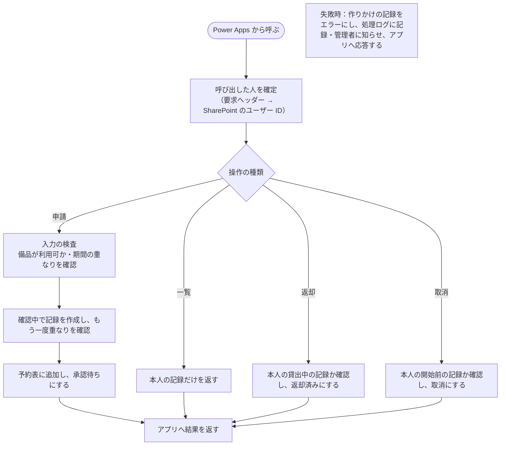

# FLW-001 利用者の操作 フロー設計書

## 文書情報

| 項目 | 内容 |
|---|---|
| 文書ID | DD-FLW-001 |
| システム名 | 備品・PC の貸出管理 |
| 版 | 1.0 |
| 作成日 | 2026-11-18 |

## 改版履歴

| 版 | 日付 | 内容 |
|---|---|---|
| 1.0 | 2026-11-18 | `flows/FLW-001.json` から `tools/flow_doc.py` で作成 |

## 1. 概要

| 項目 | 内容 |
|---|---|
| フロー名 | FLW-001 利用者の操作 |
| 目的 | Power Apps から呼ばれ、申請・一覧・返却・取消を、確認してから所有者の接続で書き込む |
| 関連要件 | REQ-002、REQ-003、REQ-007、REQ-104 |
| トリガー | Power Apps から呼ぶ（引数: 操作の種類・備品 ID・開始日・返却予定日・目的・記録 ID） |
| 同時実行 | 同時の申請は、記録を「確認中」で作った後の再確認で、ID が小さい方を優先して解決する（基本設計 2章） |
| 想定件数 | 1回 1件。1日 数十回 |
| 手順の数 | 86 |

式・設定の全文は [`flows/FLW-001.json`](../../flows/FLW-001.json)（生成元は `tools/gen_flows.py`）を参照する。

## 2. 全体図

大きな流れだけを示す。条件・分岐・繰り返しの中の手順は、4章のステップ一覧に書く。

## 3. トリガー

| 種類 | 内容 |
|---|---|
| Power Apps から呼ぶ | Power Apps から呼ぶ（引数: 操作の種類・備品 ID・開始日・返却予定日・目的・記録 ID） |

## 4. ステップ一覧

- No は実行の順の通し番号。「場所」は、その手順がどの範囲・繰り返し・条件・分岐の中で動くかを表す（空欄はフローの直下）。
- 実行条件は、前の手順が成功したとき以外にも動く手順だけ書く。
- 実行の記録は、氏名・メールアドレス・利用目的などを実行の記録に残さない手順に印を付ける（詳細設計 2.4）。

| No | ステップ | 種類 | 場所 | 実行条件 | 実行の記録 |
|---|---|---|---|---|---|
| 1 | 結果 | 変数の初期化 |  |  |  |
| 2 | メッセージ | 変数の初期化 |  |  |  |
| 3 | データ | 変数の初期化 |  |  |  |
| 4 | 利用者ID | 変数の初期化 |  |  |  |
| 5 | 新しい記録ID | 変数の初期化 |  |  |  |
| 6 | 管理者メール | 変数の初期化 |  |  |  |
| 7 | 呼び出し元 | 作成 |  |  | 入力を隠す |
| 8 | 今日 | 作成 |  |  |  |
| 9 | 試行 | 範囲 |  |  |  |
| 10 | 設定の取得 | SharePoint に HTTP 要求を送信 | 試行の中 |  |  |
| 11 | 設定の選択 | 選択 | 試行の中 |  |  |
| 12 | 設定 | 作成 | 試行の中 |  |  |
| 13 | 管理者メールの設定 | 変数の設定 | 試行の中 |  |  |
| 14 | 呼び出し元あり | 条件 | 試行の中 |  |  |
| 15 | 利用者の確認 | SharePoint に HTTP 要求を送信 | 呼び出し元あり：条件が成り立つとき |  | 入力・出力を隠す |
| 16 | 利用者の一致 | 条件 | 呼び出し元あり：条件が成り立つとき |  |  |
| 17 | 利用者IDの設定 | 変数の設定 | 利用者の一致：条件が成り立つとき |  |  |
| 18 | 操作 | 分岐 | 利用者の一致：条件が成り立つとき |  |  |
| 19 | 入力 | 作成 | 操作：「申請」のとき |  | 入力を隠す |
| 20 | 入力の検査 | 作成 | 操作：「申請」のとき |  |  |
| 21 | 入力が正しい | 条件 | 操作：「申請」のとき |  |  |
| 22 | 期間 | 作成 | 入力が正しい：条件が成り立つとき |  |  |
| 23 | 備品の取得 | SharePoint に HTTP 要求を送信 | 入力が正しい：条件が成り立つとき |  |  |
| 24 | 重なりの取得 | SharePoint に HTTP 要求を送信 | 入力が正しい：条件が成り立つとき |  |  |
| 25 | 受付できる | 条件 | 入力が正しい：条件が成り立つとき |  |  |
| 26 | 記録の作成 | SharePoint に HTTP 要求を送信 | 受付できる：条件が成り立つとき |  | 入力・出力を隠す |
| 27 | 記録IDの保持 | 変数の設定 | 受付できる：条件が成り立つとき |  |  |
| 28 | 先の重なりの取得 | SharePoint に HTTP 要求を送信 | 受付できる：条件が成り立つとき |  |  |
| 29 | 先の申請なし | 条件 | 受付できる：条件が成り立つとき |  |  |
| 30 | 予約表に追加 | SharePoint に HTTP 要求を送信 | 先の申請なし：条件が成り立つとき |  |  |
| 31 | 承認待ちにする | SharePoint に HTTP 要求を送信 | 先の申請なし：条件が成り立つとき |  |  |
| 32 | 受付の結果 | 変数の設定 | 先の申請なし：条件が成り立つとき |  |  |
| 33 | 受付のメッセージ | 変数の設定 | 先の申請なし：条件が成り立つとき |  |  |
| 34 | 先の申請に譲る | SharePoint に HTTP 要求を送信 | 先の申請なし：成り立たないとき |  |  |
| 35 | 競合の結果 | 変数の設定 | 先の申請なし：成り立たないとき |  |  |
| 36 | 競合のメッセージ | 変数の設定 | 先の申請なし：成り立たないとき |  |  |
| 37 | 不可の結果 | 変数の設定 | 受付できる：成り立たないとき |  |  |
| 38 | 不可のメッセージ | 変数の設定 | 受付できる：成り立たないとき |  |  |
| 39 | 入力の誤りの結果 | 変数の設定 | 入力が正しい：成り立たないとき |  |  |
| 40 | 入力の誤りのメッセージ | 変数の設定 | 入力が正しい：成り立たないとき |  |  |
| 41 | 自分の記録 | SharePoint に HTTP 要求を送信 | 操作：「一覧」のとき |  | 入力・出力を隠す |
| 42 | 一覧の整形 | 選択 | 操作：「一覧」のとき |  | 入力を隠す |
| 43 | 一覧のデータ | 変数の設定 | 操作：「一覧」のとき |  |  |
| 44 | 一覧の結果 | 変数の設定 | 操作：「一覧」のとき |  |  |
| 45 | 返却の対象 | SharePoint に HTTP 要求を送信 | 操作：「返却」のとき |  |  |
| 46 | 返却できる | 条件 | 操作：「返却」のとき |  |  |
| 47 | 返却にする | SharePoint に HTTP 要求を送信 | 返却できる：条件が成り立つとき |  |  |
| 48 | 返却の予約表 | SharePoint に HTTP 要求を送信 | 返却できる：条件が成り立つとき |  |  |
| 49 | 返却の予約表から消す | 繰り返し | 返却できる：条件が成り立つとき |  |  |
| 50 | 返却の予約の削除 | SharePoint に HTTP 要求を送信 | 返却の予約表から消すの中 |  |  |
| 51 | 返却の結果 | 変数の設定 | 返却できる：条件が成り立つとき |  |  |
| 52 | 返却のメッセージ | 変数の設定 | 返却できる：条件が成り立つとき |  |  |
| 53 | 返却不可の結果 | 変数の設定 | 返却できる：成り立たないとき |  |  |
| 54 | 返却不可のメッセージ | 変数の設定 | 返却できる：成り立たないとき |  |  |
| 55 | 取消の対象 | SharePoint に HTTP 要求を送信 | 操作：「取消」のとき |  |  |
| 56 | 取消できる | 条件 | 操作：「取消」のとき |  |  |
| 57 | 取消にする | SharePoint に HTTP 要求を送信 | 取消できる：条件が成り立つとき |  |  |
| 58 | 取消の予約表 | SharePoint に HTTP 要求を送信 | 取消できる：条件が成り立つとき |  |  |
| 59 | 取消の予約表から消す | 繰り返し | 取消できる：条件が成り立つとき |  |  |
| 60 | 取消の予約の削除 | SharePoint に HTTP 要求を送信 | 取消の予約表から消すの中 |  |  |
| 61 | 取消の結果 | 変数の設定 | 取消できる：条件が成り立つとき |  |  |
| 62 | 取消のメッセージ | 変数の設定 | 取消できる：条件が成り立つとき |  |  |
| 63 | 取消不可の結果 | 変数の設定 | 取消できる：成り立たないとき |  |  |
| 64 | 取消不可のメッセージ | 変数の設定 | 取消できる：成り立たないとき |  |  |
| 65 | 不明な操作の結果 | 変数の設定 | 操作：それ以外のとき |  |  |
| 66 | 不明な操作のメッセージ | 変数の設定 | 操作：それ以外のとき |  |  |
| 67 | 利用者不一致の結果 | 変数の設定 | 利用者の一致：成り立たないとき |  |  |
| 68 | 利用者不一致のメッセージ | 変数の設定 | 利用者の一致：成り立たないとき |  |  |
| 69 | 呼び出し元なしの結果 | 変数の設定 | 呼び出し元あり：成り立たないとき |  |  |
| 70 | 呼び出し元なしのメッセージ | 変数の設定 | 呼び出し元あり：成り立たないとき |  |  |
| 71 | 失敗時 | 範囲 |  | 試行 が失敗・タイムアウトのとき |  |
| 72 | 失敗した手順 | 絞り込み | 失敗時の中 |  | 入力を隠す |
| 73 | 失敗の要約 | 選択 | 失敗時の中 |  | 入力を隠す |
| 74 | 作りかけの記録あり | 条件 | 失敗時の中 | 失敗の要約 が成功・失敗・スキップ・タイムアウトのとき |  |
| 75 | 作りかけの読み直し | SharePoint に HTTP 要求を送信 | 作りかけの記録あり：条件が成り立つとき |  |  |
| 76 | まだ確認中 | 条件 | 作りかけの記録あり：条件が成り立つとき |  |  |
| 77 | 作りかけをエラーにする | SharePoint に HTTP 要求を送信 | まだ確認中：条件が成り立つとき |  |  |
| 78 | 作りかけの予約表 | SharePoint に HTTP 要求を送信 | まだ確認中：条件が成り立つとき |  |  |
| 79 | 作りかけの予約表から消す | 繰り返し | まだ確認中：条件が成り立つとき |  |  |
| 80 | 作りかけの予約の削除 | SharePoint に HTTP 要求を送信 | 作りかけの予約表から消すの中 |  |  |
| 81 | 処理ログに記録 | SharePoint に HTTP 要求を送信 | 失敗時の中 | 作りかけの記録あり が成功・失敗・スキップ・タイムアウトのとき |  |
| 82 | 管理者に知らせる | 条件 | 失敗時の中 | 処理ログに記録 が成功・失敗・スキップ・タイムアウトのとき |  |
| 83 | 管理者へのメール | メールの送信 | 管理者に知らせる：条件が成り立つとき |  | 入力・出力を隠す |
| 84 | 失敗の結果 | 変数の設定 | 失敗時の中 | 管理者に知らせる が成功・失敗・スキップ・タイムアウトのとき |  |
| 85 | 失敗のメッセージ | 変数の設定 | 失敗時の中 |  |  |
| 86 | アプリへの応答 | アプリへの応答 |  | 失敗時 が成功・失敗・スキップ・タイムアウトのとき |  |

## 5. 接続

| 接続 | 使うアカウント | 更新期限 |
|---|---|---|
| Office 365 Outlook | フローの所有者（管理者の1人） | なし（所有者のアカウントが有効な間。異動・退職のときに付け替える） |
| SharePoint | フローの所有者（管理者の1人） | なし（所有者のアカウントが有効な間。異動・退職のときに付け替える） |

## 6. エラー処理・再実行

| 項目 | 内容 |
|---|---|
| エラー時 | 「試行」の中で失敗したら「失敗時」で処理ログに記録し、管理者にメールする |
| 通知先 | 設定「管理者メール」（空ならメールは送らず、処理ログだけ） |
| 再実行の方法 | 利用者が画面からやり直す。確認中のまま残った記録は FLW-003 が1時間後にエラーにする |
| 二重実行時の影響 | 申請を2回送ると2件目は重なりで却下される。返却・取消の2回目は状態が合わず却下される |
