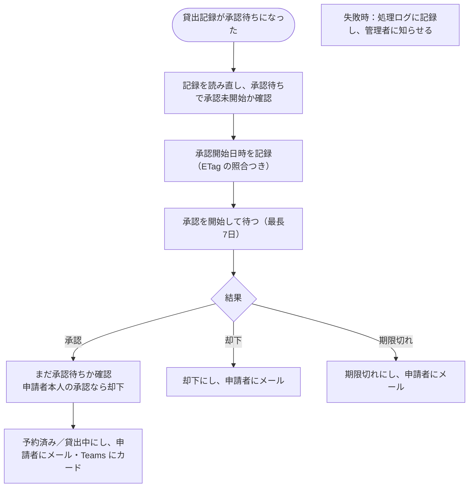

# FLW-002 承認 フロー設計書

## 文書情報

| 項目 | 内容 |
|---|---|
| 文書ID | DD-FLW-002 |
| システム名 | 備品・PC の貸出管理 |
| 版 | 1.0 |
| 作成日 | 2026-11-18 |

## 改版履歴

| 版 | 日付 | 内容 |
|---|---|---|
| 1.0 | 2026-11-18 | `flows/FLW-002.json` から `tools/flow_doc.py` で作成 |

## 1. 概要

| 項目 | 内容 |
|---|---|
| フロー名 | FLW-002 承認 |
| 目的 | 貸出記録が承認待ちになったら承認を依頼し、結果を記録して申請者に知らせる |
| 関連要件 | REQ-004、REQ-005、REQ-006 |
| トリガー | 貸出記録のアイテムが変更されたとき（1分ごとに確認。状態＝承認待ち、かつ承認開始日時が空のときだけ） |
| 同時実行 | 承認開始日時を ETag の照合つきで先に書くため、同じ記録で2本目が動いても承認依頼は1つだけ |
| 想定件数 | 1回 1件。1日 数十件 |
| 手順の数 | 52 |

式・設定の全文は [`flows/FLW-002.json`](../../flows/FLW-002.json)（生成元は `tools/gen_flows.py`）を参照する。

## 2. 全体図

大きな流れだけを示す。条件・分岐・繰り返しの中の手順は、4章のステップ一覧に書く。

## 3. トリガー

| 種類 | 内容 |
|---|---|
| SharePoint のアイテムの変更を確認 | 貸出記録のアイテムが変更されたとき（1分ごとに確認。状態＝承認待ち、かつ承認開始日時が空のときだけ） |

## 4. ステップ一覧

- No は実行の順の通し番号。「場所」は、その手順がどの範囲・繰り返し・条件・分岐の中で動くかを表す（空欄はフローの直下）。
- 実行条件は、前の手順が成功したとき以外にも動く手順だけ書く。
- 実行の記録は、氏名・メールアドレス・利用目的などを実行の記録に残さない手順に印を付ける（詳細設計 2.4）。

| No | ステップ | 種類 | 場所 | 実行条件 | 実行の記録 |
|---|---|---|---|---|---|
| 1 | 管理者メール | 変数の初期化 |  |  |  |
| 2 | 今日 | 作成 |  |  |  |
| 3 | 試行 | 範囲 |  |  |  |
| 4 | 設定の取得 | SharePoint に HTTP 要求を送信 | 試行の中 |  |  |
| 5 | 設定の選択 | 選択 | 試行の中 |  |  |
| 6 | 設定 | 作成 | 試行の中 |  |  |
| 7 | 管理者メールの設定 | 変数の設定 | 試行の中 |  |  |
| 8 | 記録の読み直し | SharePoint に HTTP 要求を送信 | 試行の中 |  | 入力・出力を隠す |
| 9 | 承認を始めてよい | 条件 | 試行の中 |  |  |
| 10 | 承認開始の記録 | SharePoint に HTTP 要求を送信 | 承認を始めてよい：条件が成り立つとき |  |  |
| 11 | 承認 | 承認を開始して待つ | 承認を始めてよい：条件が成り立つとき |  | 入力・出力を隠す |
| 12 | 承認の結果の処理 | 条件 | 承認を始めてよい：条件が成り立つとき | 承認 が成功・タイムアウトのとき |  |
| 13 | 期限後の読み直し | SharePoint に HTTP 要求を送信 | 承認の結果の処理：条件が成り立つとき |  |  |
| 14 | 期限時もまだ承認待ち | 条件 | 承認の結果の処理：条件が成り立つとき |  |  |
| 15 | 期限切れを記録 | SharePoint に HTTP 要求を送信 | 期限時もまだ承認待ち：条件が成り立つとき |  |  |
| 16 | 期限切れの予約表 | SharePoint に HTTP 要求を送信 | 期限時もまだ承認待ち：条件が成り立つとき |  |  |
| 17 | 期限切れの予約表をそろえる | 繰り返し | 期限時もまだ承認待ち：条件が成り立つとき |  |  |
| 18 | 期限切れの予約の削除 | SharePoint に HTTP 要求を送信 | 期限切れの予約表をそろえるの中 |  |  |
| 19 | 期限切れのメール | メールの送信 | 期限時もまだ承認待ち：条件が成り立つとき |  | 入力・出力を隠す |
| 20 | 結果の前の読み直し | SharePoint に HTTP 要求を送信 | 承認の結果の処理：成り立たないとき |  |  |
| 21 | まだ承認待ち | 条件 | 承認の結果の処理：成り立たないとき |  |  |
| 22 | 応答者あり | 条件 | まだ承認待ち：条件が成り立つとき |  |  |
| 23 | 応答者の確認 | SharePoint に HTTP 要求を送信 | 応答者あり：条件が成り立つとき |  | 入力・出力を隠す |
| 24 | 結果の種類 | 分岐 | 応答者あり：条件が成り立つとき |  |  |
| 25 | 承認後の状態 | 作成 | 結果の種類：「承認」のとき |  |  |
| 26 | 承認を記録 | SharePoint に HTTP 要求を送信 | 結果の種類：「承認」のとき |  | 入力・出力を隠す |
| 27 | 承認の予約表 | SharePoint に HTTP 要求を送信 | 結果の種類：「承認」のとき |  |  |
| 28 | 承認の予約表をそろえる | 繰り返し | 結果の種類：「承認」のとき |  |  |
| 29 | 承認の予約の更新 | SharePoint に HTTP 要求を送信 | 承認の予約表をそろえるの中 |  |  |
| 30 | 承認のメール | メールの送信 | 結果の種類：「承認」のとき |  | 入力・出力を隠す |
| 31 | 承認の通知 | Teams にカードを投稿 | 結果の種類：「承認」のとき |  | 入力・出力を隠す |
| 32 | 自己承認を記録 | SharePoint に HTTP 要求を送信 | 結果の種類：「自己承認」のとき |  | 入力・出力を隠す |
| 33 | 自己承認の予約表 | SharePoint に HTTP 要求を送信 | 結果の種類：「自己承認」のとき |  |  |
| 34 | 自己承認の予約表をそろえる | 繰り返し | 結果の種類：「自己承認」のとき |  |  |
| 35 | 自己承認の予約の削除 | SharePoint に HTTP 要求を送信 | 自己承認の予約表をそろえるの中 |  |  |
| 36 | 自己承認のメール | メールの送信 | 結果の種類：「自己承認」のとき |  | 入力・出力を隠す |
| 37 | 却下を記録 | SharePoint に HTTP 要求を送信 | 結果の種類：それ以外のとき |  | 入力・出力を隠す |
| 38 | 却下の予約表 | SharePoint に HTTP 要求を送信 | 結果の種類：それ以外のとき |  |  |
| 39 | 却下の予約表をそろえる | 繰り返し | 結果の種類：それ以外のとき |  |  |
| 40 | 却下の予約の削除 | SharePoint に HTTP 要求を送信 | 却下の予約表をそろえるの中 |  |  |
| 41 | 却下のメール | メールの送信 | 結果の種類：それ以外のとき |  | 入力・出力を隠す |
| 42 | 応答者不明を記録 | SharePoint に HTTP 要求を送信 | 応答者あり：成り立たないとき |  | 入力・出力を隠す |
| 43 | 応答者不明の予約表 | SharePoint に HTTP 要求を送信 | 応答者あり：成り立たないとき |  |  |
| 44 | 応答者不明の予約表をそろえる | 繰り返し | 応答者あり：成り立たないとき |  |  |
| 45 | 応答者不明の予約の削除 | SharePoint に HTTP 要求を送信 | 応答者不明の予約表をそろえるの中 |  |  |
| 46 | 応答者不明のメール | メールの送信 | 応答者あり：成り立たないとき |  | 入力・出力を隠す |
| 47 | 失敗時 | 範囲 |  | 試行 が失敗・タイムアウトのとき |  |
| 48 | 失敗した手順 | 絞り込み | 失敗時の中 |  | 入力を隠す |
| 49 | 失敗の要約 | 選択 | 失敗時の中 |  | 入力を隠す |
| 50 | 処理ログに記録 | SharePoint に HTTP 要求を送信 | 失敗時の中 | 失敗の要約 が成功・失敗・スキップ・タイムアウトのとき |  |
| 51 | 管理者に知らせる | 条件 | 失敗時の中 | 処理ログに記録 が成功・失敗・スキップ・タイムアウトのとき |  |
| 52 | 管理者へのメール | メールの送信 | 管理者に知らせる：条件が成り立つとき |  | 入力・出力を隠す |

## 5. 接続

| 接続 | 使うアカウント | 更新期限 |
|---|---|---|
| 承認 | フローの所有者（管理者の1人） | なし（所有者のアカウントが有効な間。異動・退職のときに付け替える） |
| Office 365 Outlook | フローの所有者（管理者の1人） | なし（所有者のアカウントが有効な間。異動・退職のときに付け替える） |
| SharePoint | フローの所有者（管理者の1人） | なし（所有者のアカウントが有効な間。異動・退職のときに付け替える） |
| Microsoft Teams | フローの所有者（管理者の1人） | なし（所有者のアカウントが有効な間。異動・退職のときに付け替える） |

## 6. エラー処理・再実行

| 項目 | 内容 |
|---|---|
| エラー時 | 「試行」の中で失敗したら「失敗時」で処理ログに記録し、管理者にメールする |
| 通知先 | 設定「管理者メール」（空ならメールは送らず、処理ログだけ） |
| 再実行の方法 | 承認の途中で止まった記録は、FLW-003 が8日後に期限切れにする。利用者はもう一度申請する |
| 二重実行時の影響 | 承認開始日時が入った記録では動かない |
