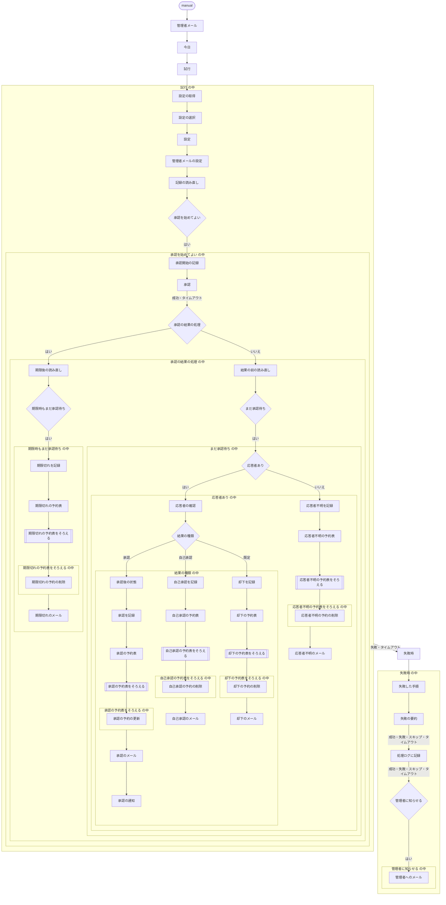

# FLW-002 承認 フロー設計書

## 文書情報

| 項目 | 内容 |
|---|---|
| 文書ID | DD-FLW-002 |
| システム名 | 備品・PC の貸出管理 |
| 版 | 0.1 |
| 作成日 | 2026-11-18 |
| 状態 | 確定 |

## 改版履歴

| 版 | 日付 | 変更内容 | 変更者 |
|---|---|---|---|
| 0.2 | 2026-11-18 | `flows/FLW-002.json` から flow_to_md.py で生成し、概要・接続・エラー処理を記入（最終監査の修正を反映） | — |

## 1. 概要

| 項目 | 内容 |
|---|---|
| フロー名 | FLW-002 承認 |
| 基盤 | Power Automate |
| 目的 | 貸出記録が承認待ちになったら承認を依頼し、結果を記録して申請者に知らせる |
| 関連要件 | REQ-004、REQ-005、REQ-006 |
| トリガー | 貸出記録のアイテムが変更されたとき（1分ごとに確認。状態＝承認待ち、かつ承認開始日時が空のときだけ） |
| 同時実行 | 承認開始日時を ETag の照合つきで先に書くため、同じ記録で2本目が動いても承認依頼は1つだけ |
| 想定件数 | 1回 1件。1日 数十件 |
| ステップ数 | 52 |

## 2. 全体図

## 3. トリガー

| No | 名前 | 種類 | 設定 | 条件・備考 |
|---|---|---|---|---|
| T1 | manual（生成のツールが全フローで同じ名前を付ける） | OpenApiConnection | interval=1, frequency=Minute、操作: GetOnUpdatedItems、dataset={{SITE_URL}}, table={{LIST_LOANS_ID}} | [{"expression":"@and(equals(triggerBody()?['LoanStatus']?['Value'], '承認待ち'), empty(triggerBody()?['ApprovalStartedAt'])… |

## 4. ステップ一覧

| No | ステップ名 | 種類 | 前のステップ（実行条件） | 主な設定 | エラー時 | 備考 |
|---|---|---|---|---|---|---|
| 1 | 管理者メール | InitializeVariable |  | variables=[{"name":"管理者メール","type":"string","value":""}] |  |  |
| 2 | 今日 | Compose | 管理者メール | @formatDateTime(convertFromUtc(utcNow(), 'Tokyo Standard Time'), 'yyyy-MM-dd') |  |  |
| 3 | 試行 | Scope | 今日 |  |  |  |
| 3.1 | 　設定の取得 | OpenApiConnection |  | 操作: HttpRequest、dataset={{SITE_URL}}, parameters/method=GET, parameters/uri=_api/web/lists/getbytitle('設定')/items?$select=Title,Setting… |  |  |
| 3.2 | 　設定の選択 | Select | 設定の取得 | from=@body('設定の取得')?['value'], select=@substring(string(setProperty(json('{}'), coalesce(item()?['Title'], ''), coalesc… |  |  |
| 3.3 | 　設定 | Compose | 設定の選択 | @json(concat('{', join(body('設定の選択'), ','), '}')) |  |  |
| 3.4 | 　管理者メールの設定 | SetVariable | 設定 | name=管理者メール, value=@{coalesce(outputs('設定')?['管理者メール'], '')} |  |  |
| 3.5 | 　記録の読み直し | OpenApiConnection | 管理者メールの設定 | 操作: HttpRequest、dataset={{SITE_URL}}, parameters/method=GET, parameters/uri=_api/web/lists/getbytitle('貸出記録')/items?$select=Id,LoanStat… |  |  |
| 3.6 | 　承認を始めてよい | If | 記録の読み直し | 条件: {"and":[{"equals":["@first(body('記録の読み直し')?['value'])?['LoanStatus']","承認待ち"]},{"equals":["@empty(first(body('記録の読み直し')… |  |  |
| 3.6.Y | 　　【はい の場合】 |  |  |  |  |  |
| 3.6.Y.1 | 　　　承認開始の記録 | OpenApiConnection |  | 操作: HttpRequest、dataset={{SITE_URL}}, parameters/method=POST, parameters/uri=_api/web/lists/getbytitle('貸出記録')/items(@{triggerBody()?['… |  |  |
| 3.6.Y.2 | 　　　承認 | OpenApiConnectionWebhook | 承認開始の記録 | 操作: StartAndWaitForAnApproval、approvalType=Basic, WebhookApprovalCreationInput/title=@{concat('【備品貸出】', first(body('記録の読み直し')?['value'])?['Equipment'… | タイムアウト P7D |  |
| 3.6.Y.3 | 　　　承認の結果の処理 | If | 承認（成功・タイムアウト時） | 条件: {"equals":["@actions('承認')?['status']","TimedOut"]} |  |  |
| 3.6.Y.3.Y | 　　　　【はい の場合】 |  |  |  |  |  |
| 3.6.Y.3.Y.1 | 　　　　　期限後の読み直し | OpenApiConnection |  | 操作: HttpRequest、dataset={{SITE_URL}}, parameters/method=GET, parameters/uri=_api/web/lists/getbytitle('貸出記録')/items?$select=Id,LoanStat… |  |  |
| 3.6.Y.3.Y.2 | 　　　　　期限時もまだ承認待ち | If | 期限後の読み直し | 条件: {"equals":["@first(body('期限後の読み直し')?['value'])?['LoanStatus']","承認待ち"]} |  |  |
| 3.6.Y.3.Y.2.Y | 　　　　　　【はい の場合】 |  |  |  |  |  |
| 3.6.Y.3.Y.2.Y.1 | 　　　　　　　期限切れを記録 | OpenApiConnection |  | 操作: HttpRequest、dataset={{SITE_URL}}, parameters/method=POST, parameters/uri=_api/web/lists/getbytitle('貸出記録')/items(@{triggerBody()?['… |  |  |
| 3.6.Y.3.Y.2.Y.2 | 　　　　　　　期限切れの予約表 | OpenApiConnection | 期限切れを記録 | 操作: HttpRequest、dataset={{SITE_URL}}, parameters/method=GET, parameters/uri=_api/web/lists/getbytitle('予約表')/items?$select=Id&$filter=T… |  |  |
| 3.6.Y.3.Y.2.Y.3 | 　　　　　　　期限切れの予約表をそろえる | Foreach | 期限切れの予約表 | 対象: @body('期限切れの予約表')?['value'] |  |  |
| 3.6.Y.3.Y.2.Y.3.1 | 　　　　　　　　期限切れの予約の削除 | OpenApiConnection |  | 操作: HttpRequest、dataset={{SITE_URL}}, parameters/method=POST, parameters/uri=_api/web/lists/getbytitle('予約表')/items(@{items('期限切れの予約表をそ… |  |  |
| 3.6.Y.3.Y.2.Y.4 | 　　　　　　　期限切れのメール | OpenApiConnection | 期限切れの予約表をそろえる | 操作: SendEmailV2、emailMessage/To=@{first(body('記録の読み直し')?['value'])?['Requester']?['EMail']}, emailMessage/Subject=@{concat('【備品貸出】承認の期限… |  |  |
| 3.6.Y.3.N | 　　　　【いいえ の場合】 |  |  |  |  |  |
| 3.6.Y.3.N.1 | 　　　　　結果の前の読み直し | OpenApiConnection |  | 操作: HttpRequest、dataset={{SITE_URL}}, parameters/method=GET, parameters/uri=_api/web/lists/getbytitle('貸出記録')/items?$select=Id,LoanStat… |  |  |
| 3.6.Y.3.N.2 | 　　　　　まだ承認待ち | If | 結果の前の読み直し | 条件: {"equals":["@first(body('結果の前の読み直し')?['value'])?['LoanStatus']","承認待ち"]} |  |  |
| 3.6.Y.3.N.2.Y | 　　　　　　【はい の場合】 |  |  |  |  |  |
| 3.6.Y.3.N.2.Y.1 | 　　　　　　　応答者あり | If |  | 条件: {"not":{"equals":["@toLower(coalesce(first(body('承認')?['responses'])?['responder']?['email'], ''))",""]}} |  |  |
| 3.6.Y.3.N.2.Y.1.Y | 　　　　　　　　【はい の場合】 |  |  |  |  |  |
| 3.6.Y.3.N.2.Y.1.Y.1 | 　　　　　　　　　応答者の確認 | OpenApiConnection |  | 操作: HttpRequest、dataset={{SITE_URL}}, parameters/method=POST, parameters/uri=_api/web/ensureuser, parameters/headers={"Accept":"applica… |  |  |
| 3.6.Y.3.N.2.Y.1.Y.2 | 　　　　　　　　　結果の種類 | Switch | 応答者の確認 | 値: @if(equals(body('承認')?['outcome'], 'Approve'), if(and(equals(int(body('応答者の確認')?['Id']), int(first(body('記録の読み直し')?['va… |  |  |
| 3.6.Y.3.N.2.Y.1.Y.2.1 | 　　　　　　　　　　【ケース 承認：承認】 |  |  |  |  |  |
| 3.6.Y.3.N.2.Y.1.Y.2.1.1 | 　　　　　　　　　　　承認後の状態 | Compose |  | @if(lessOrEquals(formatDateTime(convertFromUtc(first(body('記録の読み直し')?['value'])?['StartDate'], 'Tokyo Standard Time'), … |  |  |
| 3.6.Y.3.N.2.Y.1.Y.2.1.2 | 　　　　　　　　　　　承認を記録 | OpenApiConnection | 承認後の状態 | 操作: HttpRequest、dataset={{SITE_URL}}, parameters/method=POST, parameters/uri=_api/web/lists/getbytitle('貸出記録')/items(@{triggerBody()?['… |  |  |
| 3.6.Y.3.N.2.Y.1.Y.2.1.3 | 　　　　　　　　　　　承認の予約表 | OpenApiConnection | 承認を記録 | 操作: HttpRequest、dataset={{SITE_URL}}, parameters/method=GET, parameters/uri=_api/web/lists/getbytitle('予約表')/items?$select=Id&$filter=T… |  |  |
| 3.6.Y.3.N.2.Y.1.Y.2.1.4 | 　　　　　　　　　　　承認の予約表をそろえる | Foreach | 承認の予約表 | 対象: @body('承認の予約表')?['value'] |  |  |
| 3.6.Y.3.N.2.Y.1.Y.2.1.4.1 | 　　　　　　　　　　　　承認の予約の更新 | OpenApiConnection |  | 操作: HttpRequest、dataset={{SITE_URL}}, parameters/method=POST, parameters/uri=_api/web/lists/getbytitle('予約表')/items(@{items('承認の予約表をそろえ… |  |  |
| 3.6.Y.3.N.2.Y.1.Y.2.1.5 | 　　　　　　　　　　　承認のメール | OpenApiConnection | 承認の予約表をそろえる | 操作: SendEmailV2、emailMessage/To=@{first(body('記録の読み直し')?['value'])?['Requester']?['EMail']}, emailMessage/Subject=@{concat('【備品貸出】承認されま… |  |  |
| 3.6.Y.3.N.2.Y.1.Y.2.1.6 | 　　　　　　　　　　　承認の通知 | OpenApiConnection | 承認のメール | 操作: PostCardToConversation、poster=Flow bot, location=Channel, body/recipient/groupId={{TEAM_ID}}, body/recipient/channelId={{CHANNEL_ID}}, body/me… |  |  |
| 3.6.Y.3.N.2.Y.1.Y.2.2 | 　　　　　　　　　　【ケース 自己承認：自己承認】 |  |  |  |  |  |
| 3.6.Y.3.N.2.Y.1.Y.2.2.1 | 　　　　　　　　　　　自己承認を記録 | OpenApiConnection |  | 操作: HttpRequest、dataset={{SITE_URL}}, parameters/method=POST, parameters/uri=_api/web/lists/getbytitle('貸出記録')/items(@{triggerBody()?['… |  |  |
| 3.6.Y.3.N.2.Y.1.Y.2.2.2 | 　　　　　　　　　　　自己承認の予約表 | OpenApiConnection | 自己承認を記録 | 操作: HttpRequest、dataset={{SITE_URL}}, parameters/method=GET, parameters/uri=_api/web/lists/getbytitle('予約表')/items?$select=Id&$filter=T… |  |  |
| 3.6.Y.3.N.2.Y.1.Y.2.2.3 | 　　　　　　　　　　　自己承認の予約表をそろえる | Foreach | 自己承認の予約表 | 対象: @body('自己承認の予約表')?['value'] |  |  |
| 3.6.Y.3.N.2.Y.1.Y.2.2.3.1 | 　　　　　　　　　　　　自己承認の予約の削除 | OpenApiConnection |  | 操作: HttpRequest、dataset={{SITE_URL}}, parameters/method=POST, parameters/uri=_api/web/lists/getbytitle('予約表')/items(@{items('自己承認の予約表をそ… |  |  |
| 3.6.Y.3.N.2.Y.1.Y.2.2.4 | 　　　　　　　　　　　自己承認のメール | OpenApiConnection | 自己承認の予約表をそろえる | 操作: SendEmailV2、emailMessage/To=@{first(body('記録の読み直し')?['value'])?['Requester']?['EMail']}, emailMessage/Subject=@{concat('【備品貸出】却下されま… |  |  |
| 3.6.Y.3.N.2.Y.1.Y.2.D | 　　　　　　　　　　【既定】 |  |  |  |  |  |
| 3.6.Y.3.N.2.Y.1.Y.2.D.1 | 　　　　　　　　　　　却下を記録 | OpenApiConnection |  | 操作: HttpRequest、dataset={{SITE_URL}}, parameters/method=POST, parameters/uri=_api/web/lists/getbytitle('貸出記録')/items(@{triggerBody()?['… |  |  |
| 3.6.Y.3.N.2.Y.1.Y.2.D.2 | 　　　　　　　　　　　却下の予約表 | OpenApiConnection | 却下を記録 | 操作: HttpRequest、dataset={{SITE_URL}}, parameters/method=GET, parameters/uri=_api/web/lists/getbytitle('予約表')/items?$select=Id&$filter=T… |  |  |
| 3.6.Y.3.N.2.Y.1.Y.2.D.3 | 　　　　　　　　　　　却下の予約表をそろえる | Foreach | 却下の予約表 | 対象: @body('却下の予約表')?['value'] |  |  |
| 3.6.Y.3.N.2.Y.1.Y.2.D.3.1 | 　　　　　　　　　　　　却下の予約の削除 | OpenApiConnection |  | 操作: HttpRequest、dataset={{SITE_URL}}, parameters/method=POST, parameters/uri=_api/web/lists/getbytitle('予約表')/items(@{items('却下の予約表をそろえ… |  |  |
| 3.6.Y.3.N.2.Y.1.Y.2.D.4 | 　　　　　　　　　　　却下のメール | OpenApiConnection | 却下の予約表をそろえる | 操作: SendEmailV2、emailMessage/To=@{first(body('記録の読み直し')?['value'])?['Requester']?['EMail']}, emailMessage/Subject=@{concat('【備品貸出】却下されま… |  |  |
| 3.6.Y.3.N.2.Y.1.N | 　　　　　　　　【いいえ の場合】 |  |  |  |  |  |
| 3.6.Y.3.N.2.Y.1.N.1 | 　　　　　　　　　応答者不明を記録 | OpenApiConnection |  | 操作: HttpRequest、dataset={{SITE_URL}}, parameters/method=POST, parameters/uri=_api/web/lists/getbytitle('貸出記録')/items(@{triggerBody()?['… |  |  |
| 3.6.Y.3.N.2.Y.1.N.2 | 　　　　　　　　　応答者不明の予約表 | OpenApiConnection | 応答者不明を記録 | 操作: HttpRequest、dataset={{SITE_URL}}, parameters/method=GET, parameters/uri=_api/web/lists/getbytitle('予約表')/items?$select=Id&$filter=T… |  |  |
| 3.6.Y.3.N.2.Y.1.N.3 | 　　　　　　　　　応答者不明の予約表をそろえる | Foreach | 応答者不明の予約表 | 対象: @body('応答者不明の予約表')?['value'] |  |  |
| 3.6.Y.3.N.2.Y.1.N.3.1 | 　　　　　　　　　　応答者不明の予約の削除 | OpenApiConnection |  | 操作: HttpRequest、dataset={{SITE_URL}}, parameters/method=POST, parameters/uri=_api/web/lists/getbytitle('予約表')/items(@{items('応答者不明の予約表を… |  |  |
| 3.6.Y.3.N.2.Y.1.N.4 | 　　　　　　　　　応答者不明のメール | OpenApiConnection | 応答者不明の予約表をそろえる | 操作: SendEmailV2、emailMessage/To=@{first(body('記録の読み直し')?['value'])?['Requester']?['EMail']}, emailMessage/Subject=@{concat('【備品貸出】却下されま… |  |  |
| 4 | 失敗時 | Scope | 試行（失敗・タイムアウト時） |  |  |  |
| 4.1 | 　失敗した手順 | Query |  | from=@result('試行'), where=@equals(item()?['status'], 'Failed') |  |  |
| 4.2 | 　失敗の要約 | Select | 失敗した手順 | from=@body('失敗した手順'), select=@concat(item()?['name'], ':', coalesce(item()?['code'], '')) |  |  |
| 4.3 | 　処理ログに記録 | OpenApiConnection | 失敗の要約（成功・失敗・スキップ・タイムアウト時） | 操作: HttpRequest、dataset={{SITE_URL}}, parameters/method=POST, parameters/uri=_api/web/lists/getbytitle('処理ログ')/items, parameters/header… |  |  |
| 4.4 | 　管理者に知らせる | If | 処理ログに記録（成功・失敗・スキップ・タイムアウト時） | 条件: {"not":{"equals":["@variables('管理者メール')",""]}} |  |  |
| 4.4.Y | 　　【はい の場合】 |  |  |  |  |  |
| 4.4.Y.1 | 　　　管理者へのメール | OpenApiConnection |  | 操作: SendEmailV2、emailMessage/To=@variables('管理者メール'), emailMessage/Subject=【備品貸出】処理に失敗しました（FLW-002 承認）, emailMessage/Body=
FLW-002 承認… |  |  |

## 5. 接続・資格情報

| 接続・資格情報 | 使用アカウント | 使用ステップ | 更新期限 |
|---|---|---|---|
| shared_sharepointonline / shared_sharepointonline | フローの所有者（管理者の1人） | manual、処理ログに記録、却下の予約の削除、却下の予約表、却下を記録、応答者の確認、応答者不明の予約の削除、応答者不明の予約表、応答者不明を記録、承認の予約の更新、承認の予約表、承認を記録、承認開始の記録、期限切れの予約の削除、期限切れの予約表、期限切れを記録、期限後の読み直し、結果の前の読み直し、自己承認の予約の削除、自己承認の予約表、自己承認を記録、記録の読み直し、設定の取得 | なし（所有者のアカウントが有効な間。異動・退職のときに付け替える） |
| shared_approvals / shared_approvals | フローの所有者（管理者の1人） | 承認 | なし（所有者のアカウントが有効な間。異動・退職のときに付け替える） |
| shared_office365 / shared_office365 | フローの所有者（管理者の1人） | 却下のメール、応答者不明のメール、承認のメール、期限切れのメール、管理者へのメール、自己承認のメール | なし（所有者のアカウントが有効な間。異動・退職のときに付け替える） |
| shared_teams / shared_teams | フローの所有者（管理者の1人） | 承認の通知 | なし（所有者のアカウントが有効な間。異動・退職のときに付け替える） |

## 6. エラー処理・再実行

| 項目 | 内容 |
|---|---|
| エラー時の分岐 | あり（ステップ一覧の「エラー時」「実行条件」参照） |
| 通知先 | 設定「管理者メール」（空ならメールは送らず、処理ログだけ） |
| 再実行の方法 | 承認の途中で止まった記録は、FLW-003 が8日後に期限切れにする。利用者はもう一度申請する |
| 二重実行時の影響 | 承認開始日時が入った記録では動かない |

## 7. 未決事項

| No | 内容 | 確認先 | 状態 |
|---|---|---|---|
| 1 | なし（実施していない試験は 05 テスト仕様書の3章） | — | — |
