# FLW-003 期限の通知・督促 フロー設計書

## 文書情報

| 項目 | 内容 |
|---|---|
| 文書ID | DD-FLW-003 |
| システム名 | 備品・PC の貸出管理 |
| 版 | 0.1 |
| 作成日 | 2026-11-18 |
| 状態 | 確定 |

## 改版履歴

| 版 | 日付 | 変更内容 | 変更者 |
|---|---|---|---|
| 0.2 | 2026-11-18 | `flows/FLW-003.json` から flow_to_md.py で生成し、概要・接続・エラー処理を記入（最終監査の修正を反映） | — |

## 1. 概要

| 項目 | 内容 |
|---|---|
| フロー名 | FLW-003 期限の通知・督促 |
| 基盤 | Power Automate |
| 目的 | 毎朝、開始日を迎えた予約を貸出中にし、返却期限のお知らせ・督促と、止まった記録の後始末をする |
| 関連要件 | REQ-005、REQ-006、REQ-008 |
| トリガー | 毎朝 9:00（日本時間） |
| 同時実行 | 1日1回だけ動く |
| 想定件数 | 1回 数件〜数十件 |
| ステップ数 | 56 |

## 2. 全体図

```mermaid
flowchart TD
    n1(["manual"])
    n2["管理者メール"]
    n3["今日"]
    n4["試行"]
    subgraph gn4["試行 の中"]
        n5["設定の取得"]
        n6["設定の選択"]
        n7["設定"]
        n8["管理者メールの設定"]
        n9["開始日の切り替え"]
        subgraph gn9["開始日の切り替え の中"]
            n10["予約済みの取得"]
            n11["開始日の記録"]
            n12[["開始日の記録ごと"]]
            subgraph gn12["開始日の記録ごと の中"]
                n13["貸出中にする"]
                n14["開始の予約表"]
                n15[["開始の予約表をそろえる"]]
                subgraph gn15["開始の予約表をそろえる の中"]
                    n16["開始の予約の更新"]
                end
            end
        end
        n17["前日のお知らせ"]
        subgraph gn17["前日のお知らせ の中"]
            n18["貸出中の取得"]
            n19["期限が翌日"]
            n20[["前日のお知らせごと"]]
            subgraph gn20["前日のお知らせごと の中"]
                n21["お知らせのメール"]
                n22["お知らせ済みにする"]
            end
        end
        n23["督促"]
        subgraph gn23["督促 の中"]
            n24["督促対象の取得"]
            n25["期限切れ"]
            n26[["督促ごと"]]
            subgraph gn26["督促ごと の中"]
                n27["督促の回数"]
                n28["督促のメール"]
                n29["督促を記録"]
                n30{"上限に達した"}
                subgraph gn30["上限に達した の中"]
                    n31{"上限を管理者に知らせる"}
                    subgraph gn31["上限を管理者に知らせる の中"]
                        n32["上限の管理者メール"]
                    end
                    n33["上限の通知"]
                end
            end
        end
        n34["止まった承認待ちの後始末"]
        subgraph gn34["止まった承認待ちの後始末 の中"]
            n35["承認待ちの取得"]
            n36["止まった承認待ち"]
            n37[["止まった承認待ちごと"]]
            subgraph gn37["止まった承認待ちごと の中"]
                n38["止まった記録を期限切れにする"]
                n39["止まったの予約表"]
                n40[["止まったの予約表をそろえる"]]
                subgraph gn40["止まったの予約表をそろえる の中"]
                    n41["止まったの予約の削除"]
                end
                n42["止まった記録のメール"]
            end
        end
        n43["作りかけの後始末"]
        subgraph gn43["作りかけの後始末 の中"]
            n44["確認中の取得"]
            n45["作りかけ"]
            n46[["作りかけごと"]]
            subgraph gn46["作りかけごと の中"]
                n47["作りかけをエラーにする"]
                n48["作りかけの予約表"]
                n49[["作りかけの予約表をそろえる"]]
                subgraph gn49["作りかけの予約表をそろえる の中"]
                    n50["作りかけの予約の削除"]
                end
            end
        end
    end
    n51["失敗時"]
    subgraph gn51["失敗時 の中"]
        n52{"失敗があった"}
        subgraph gn52["失敗があった の中"]
            n53["失敗した手順"]
            n54["失敗の要約"]
            n55["処理ログに記録"]
            n56{"管理者に知らせる"}
            subgraph gn56["管理者に知らせる の中"]
                n57["管理者へのメール"]
            end
        end
    end
    n1 --> n2
    n2 --> n3
    n3 --> n4
    n4 --> n5
    n5 --> n6
    n6 --> n7
    n7 --> n8
    n8 -->|"成功・失敗・スキップ・タイムアウト"| n9
    n9 --> n10
    n10 --> n11
    n11 --> n12
    n12 --> n13
    n13 --> n14
    n14 --> n15
    n15 --> n16
    gn9 -->|"成功・失敗・スキップ・タイムアウト"| n17
    n17 --> n18
    n18 --> n19
    n19 --> n20
    n20 --> n21
    n21 --> n22
    gn17 -->|"成功・失敗・スキップ・タイムアウト"| n23
    n23 --> n24
    n24 --> n25
    n25 --> n26
    n26 --> n27
    n27 --> n28
    n28 --> n29
    n29 --> n30
    n31 -->|"はい"| n32
    gn31 --> n33
    n30 -->|"はい"| n31
    gn23 -->|"成功・失敗・スキップ・タイムアウト"| n34
    n34 --> n35
    n35 --> n36
    n36 --> n37
    n37 --> n38
    n38 --> n39
    n39 --> n40
    n40 --> n41
    gn40 --> n42
    gn34 -->|"成功・失敗・スキップ・タイムアウト"| n43
    n43 --> n44
    n44 --> n45
    n45 --> n46
    n46 --> n47
    n47 --> n48
    n48 --> n49
    n49 --> n50
    gn4 -->|"成功・失敗・スキップ・タイムアウト"| n51
    n51 --> n52
    n53 --> n54
    n54 -->|"成功・失敗・スキップ・タイムアウト"| n55
    n55 -->|"成功・失敗・スキップ・タイムアウト"| n56
    n56 -->|"はい"| n57
    n52 -->|"はい"| n53
```

## 3. トリガー

| No | 名前 | 種類 | 設定 | 条件・備考 |
|---|---|---|---|---|
| T1 | manual（生成のツールが全フローで同じ名前を付ける） | Recurrence | frequency=Day, interval=1, timeZone=Tokyo Standard Time, schedule={"hours":["9"],"minutes":[0]} |  |

## 4. ステップ一覧

| No | ステップ名 | 種類 | 前のステップ（実行条件） | 主な設定 | エラー時 | 備考 |
|---|---|---|---|---|---|---|
| 1 | 管理者メール | InitializeVariable |  | variables=[{"name":"管理者メール","type":"string","value":""}] |  |  |
| 2 | 今日 | Compose | 管理者メール | @formatDateTime(convertFromUtc(utcNow(), 'Tokyo Standard Time'), 'yyyy-MM-dd') |  |  |
| 3 | 試行 | Scope | 今日 |  |  |  |
| 3.1 | 　設定の取得 | OpenApiConnection |  | 操作: HttpRequest、dataset={{SITE_URL}}, parameters/method=GET, parameters/uri=_api/web/lists/getbytitle('設定')/items?$select=Title,Setting… |  |  |
| 3.2 | 　設定の選択 | Select | 設定の取得 | from=@body('設定の取得')?['value'], select=@substring(string(setProperty(json('{}'), coalesce(item()?['Title'], ''), coalesc… |  |  |
| 3.3 | 　設定 | Compose | 設定の選択 | @json(concat('{', join(body('設定の選択'), ','), '}')) |  |  |
| 3.4 | 　管理者メールの設定 | SetVariable | 設定 | name=管理者メール, value=@{coalesce(outputs('設定')?['管理者メール'], '')} |  |  |
| 3.5 | 　開始日の切り替え | Scope | 管理者メールの設定（成功・失敗・スキップ・タイムアウト時） |  |  |  |
| 3.5.1 | 　　予約済みの取得 | OpenApiConnection |  | 操作: HttpRequest、dataset={{SITE_URL}}, parameters/method=GET, parameters/uri=_api/web/lists/getbytitle('貸出記録')/items?$select=Id,LoanStat… |  |  |
| 3.5.2 | 　　開始日の記録 | Query | 予約済みの取得 | from=@body('予約済みの取得')?['value'], where=@true |  |  |
| 3.5.3 | 　　開始日の記録ごと | Foreach | 開始日の記録 | 対象: @body('開始日の記録')（逐次） |  |  |
| 3.5.3.1 | 　　　貸出中にする | OpenApiConnection |  | 操作: HttpRequest、dataset={{SITE_URL}}, parameters/method=POST, parameters/uri=_api/web/lists/getbytitle('貸出記録')/items(@{items('開始日の記録ごと'… |  |  |
| 3.5.3.2 | 　　　開始の予約表 | OpenApiConnection | 貸出中にする | 操作: HttpRequest、dataset={{SITE_URL}}, parameters/method=GET, parameters/uri=_api/web/lists/getbytitle('予約表')/items?$select=Id&$filter=T… |  |  |
| 3.5.3.3 | 　　　開始の予約表をそろえる | Foreach | 開始の予約表 | 対象: @body('開始の予約表')?['value'] |  |  |
| 3.5.3.3.1 | 　　　　開始の予約の更新 | OpenApiConnection |  | 操作: HttpRequest、dataset={{SITE_URL}}, parameters/method=POST, parameters/uri=_api/web/lists/getbytitle('予約表')/items(@{items('開始の予約表をそろえ… |  |  |
| 3.6 | 　前日のお知らせ | Scope | 開始日の切り替え（成功・失敗・スキップ・タイムアウト時） |  |  |  |
| 3.6.1 | 　　貸出中の取得 | OpenApiConnection |  | 操作: HttpRequest、dataset={{SITE_URL}}, parameters/method=GET, parameters/uri=_api/web/lists/getbytitle('貸出記録')/items?$select=Id,LoanStat… |  |  |
| 3.6.2 | 　　期限が翌日 | Query | 貸出中の取得 | from=@body('貸出中の取得')?['value'], where=@and(equals(formatDateTime(convertFromUtc(item()?['DueDate'], 'Tokyo Standard Tim… |  |  |
| 3.6.3 | 　　前日のお知らせごと | Foreach | 期限が翌日 | 対象: @body('期限が翌日')（逐次） |  |  |
| 3.6.3.1 | 　　　お知らせのメール | OpenApiConnection |  | 操作: SendEmailV2、emailMessage/To=@{items('前日のお知らせごと')?['Requester']?['EMail']}, emailMessage/Subject=@{concat('【備品貸出】返却期限は明日です：', items(… |  |  |
| 3.6.3.2 | 　　　お知らせ済みにする | OpenApiConnection | お知らせのメール | 操作: HttpRequest、dataset={{SITE_URL}}, parameters/method=POST, parameters/uri=_api/web/lists/getbytitle('貸出記録')/items(@{items('前日のお知らせごと… |  |  |
| 3.7 | 　督促 | Scope | 前日のお知らせ（成功・失敗・スキップ・タイムアウト時） |  |  |  |
| 3.7.1 | 　　督促対象の取得 | OpenApiConnection |  | 操作: HttpRequest、dataset={{SITE_URL}}, parameters/method=GET, parameters/uri=_api/web/lists/getbytitle('貸出記録')/items?$select=Id,LoanStat… |  |  |
| 3.7.2 | 　　期限切れ | Query | 督促対象の取得 | from=@body('督促対象の取得')?['value'], where=@and(less(formatDateTime(convertFromUtc(item()?['DueDate'], 'Tokyo Standard Time… |  |  |
| 3.7.3 | 　　督促ごと | Foreach | 期限切れ | 対象: @body('期限切れ')（逐次） |  |  |
| 3.7.3.1 | 　　　督促の回数 | Compose |  | @add(int(coalesce(items('督促ごと')?['ReminderCount'], 0)), 1) |  |  |
| 3.7.3.2 | 　　　督促のメール | OpenApiConnection | 督促の回数 | 操作: SendEmailV2、emailMessage/To=@{items('督促ごと')?['Requester']?['EMail']}, emailMessage/Subject=@{concat('【備品貸出】返却期限を過ぎています（督促', string(… |  |  |
| 3.7.3.3 | 　　　督促を記録 | OpenApiConnection | 督促のメール | 操作: HttpRequest、dataset={{SITE_URL}}, parameters/method=POST, parameters/uri=_api/web/lists/getbytitle('貸出記録')/items(@{items('督促ごと')?['… |  |  |
| 3.7.3.4 | 　　　上限に達した | If | 督促を記録 | 条件: {"greaterOrEquals":["@outputs('督促の回数')","@int(if(empty(outputs('設定')?['督促上限回数']), '5', outputs('設定')?['督促上限回数']))"]} |  |  |
| 3.7.3.4.Y | 　　　　【はい の場合】 |  |  |  |  |  |
| 3.7.3.4.Y.1 | 　　　　　上限を管理者に知らせる | If |  | 条件: {"not":{"equals":["@variables('管理者メール')",""]}} |  |  |
| 3.7.3.4.Y.1.Y | 　　　　　　【はい の場合】 |  |  |  |  |  |
| 3.7.3.4.Y.1.Y.1 | 　　　　　　　上限の管理者メール | OpenApiConnection |  | 操作: SendEmailV2、emailMessage/To=@variables('管理者メール'), emailMessage/Subject=@{concat('【備品貸出】督促が上限に達しました：', items('督促ごと')?['Equipment']?[… |  |  |
| 3.7.3.4.Y.2 | 　　　　　上限の通知 | OpenApiConnection | 上限を管理者に知らせる | 操作: PostCardToConversation、poster=Flow bot, location=Channel, body/recipient/groupId={{TEAM_ID}}, body/recipient/channelId={{CHANNEL_ID}}, body/me… |  |  |
| 3.8 | 　止まった承認待ちの後始末 | Scope | 督促（成功・失敗・スキップ・タイムアウト時） |  |  |  |
| 3.8.1 | 　　承認待ちの取得 | OpenApiConnection |  | 操作: HttpRequest、dataset={{SITE_URL}}, parameters/method=GET, parameters/uri=_api/web/lists/getbytitle('貸出記録')/items?$select=Id,LoanStat… |  |  |
| 3.8.2 | 　　止まった承認待ち | Query | 承認待ちの取得 | from=@body('承認待ちの取得')?['value'], where=@or(and(not(empty(item()?['ApprovalStartedAt'])), less(ticks(coalesce(item()?['A… |  |  |
| 3.8.3 | 　　止まった承認待ちごと | Foreach | 止まった承認待ち | 対象: @body('止まった承認待ち')（逐次） |  |  |
| 3.8.3.1 | 　　　止まった記録を期限切れにする | OpenApiConnection |  | 操作: HttpRequest、dataset={{SITE_URL}}, parameters/method=POST, parameters/uri=_api/web/lists/getbytitle('貸出記録')/items(@{items('止まった承認待ちご… |  |  |
| 3.8.3.2 | 　　　止まったの予約表 | OpenApiConnection | 止まった記録を期限切れにする | 操作: HttpRequest、dataset={{SITE_URL}}, parameters/method=GET, parameters/uri=_api/web/lists/getbytitle('予約表')/items?$select=Id&$filter=T… |  |  |
| 3.8.3.3 | 　　　止まったの予約表をそろえる | Foreach | 止まったの予約表 | 対象: @body('止まったの予約表')?['value'] |  |  |
| 3.8.3.3.1 | 　　　　止まったの予約の削除 | OpenApiConnection |  | 操作: HttpRequest、dataset={{SITE_URL}}, parameters/method=POST, parameters/uri=_api/web/lists/getbytitle('予約表')/items(@{items('止まったの予約表をそ… |  |  |
| 3.8.3.4 | 　　　止まった記録のメール | OpenApiConnection | 止まったの予約表をそろえる | 操作: SendEmailV2、emailMessage/To=@{items('止まった承認待ちごと')?['Requester']?['EMail']}, emailMessage/Subject=@{concat('【備品貸出】申請を期限切れにしました：', it… |  |  |
| 3.9 | 　作りかけの後始末 | Scope | 止まった承認待ちの後始末（成功・失敗・スキップ・タイムアウト時） |  |  |  |
| 3.9.1 | 　　確認中の取得 | OpenApiConnection |  | 操作: HttpRequest、dataset={{SITE_URL}}, parameters/method=GET, parameters/uri=_api/web/lists/getbytitle('貸出記録')/items?$select=Id,LoanStat… |  |  |
| 3.9.2 | 　　作りかけ | Query | 確認中の取得 | from=@body('確認中の取得')?['value'], where=@less(ticks(item()?['Created']), ticks(addHours(utcNow(), -1))) |  |  |
| 3.9.3 | 　　作りかけごと | Foreach | 作りかけ | 対象: @body('作りかけ')（逐次） |  |  |
| 3.9.3.1 | 　　　作りかけをエラーにする | OpenApiConnection |  | 操作: HttpRequest、dataset={{SITE_URL}}, parameters/method=POST, parameters/uri=_api/web/lists/getbytitle('貸出記録')/items(@{items('作りかけごと')?… |  |  |
| 3.9.3.2 | 　　　作りかけの予約表 | OpenApiConnection | 作りかけをエラーにする | 操作: HttpRequest、dataset={{SITE_URL}}, parameters/method=GET, parameters/uri=_api/web/lists/getbytitle('予約表')/items?$select=Id&$filter=T… |  |  |
| 3.9.3.3 | 　　　作りかけの予約表をそろえる | Foreach | 作りかけの予約表 | 対象: @body('作りかけの予約表')?['value'] |  |  |
| 3.9.3.3.1 | 　　　　作りかけの予約の削除 | OpenApiConnection |  | 操作: HttpRequest、dataset={{SITE_URL}}, parameters/method=POST, parameters/uri=_api/web/lists/getbytitle('予約表')/items(@{items('作りかけの予約表をそ… |  |  |
| 4 | 失敗時 | Scope | 試行（成功・失敗・スキップ・タイムアウト時） |  |  |  |
| 4.1 | 　失敗があった | If |  | 条件: {"or":[{"equals":["@actions('設定の取得')?['status']","Failed"]},{"equals":["@actions('開始日の切り替え')?['status']","Failed"]},{"e… |  |  |
| 4.1.Y | 　　【はい の場合】 |  |  |  |  |  |
| 4.1.Y.1 | 　　　失敗した手順 | Query |  | from=@result('試行'), where=@equals(item()?['status'], 'Failed') |  |  |
| 4.1.Y.2 | 　　　失敗の要約 | Select | 失敗した手順 | from=@body('失敗した手順'), select=@concat(item()?['name'], ':', coalesce(item()?['code'], '')) |  |  |
| 4.1.Y.3 | 　　　処理ログに記録 | OpenApiConnection | 失敗の要約（成功・失敗・スキップ・タイムアウト時） | 操作: HttpRequest、dataset={{SITE_URL}}, parameters/method=POST, parameters/uri=_api/web/lists/getbytitle('処理ログ')/items, parameters/header… |  |  |
| 4.1.Y.4 | 　　　管理者に知らせる | If | 処理ログに記録（成功・失敗・スキップ・タイムアウト時） | 条件: {"not":{"equals":["@variables('管理者メール')",""]}} |  |  |
| 4.1.Y.4.Y | 　　　　【はい の場合】 |  |  |  |  |  |
| 4.1.Y.4.Y.1 | 　　　　　管理者へのメール | OpenApiConnection |  | 操作: SendEmailV2、emailMessage/To=@variables('管理者メール'), emailMessage/Subject=【備品貸出】処理に失敗しました（FLW-003 期限の通知・督促）, emailMessage/Body=
FLW-… |  |  |

## 5. 接続・資格情報

| 接続・資格情報 | 使用アカウント | 使用ステップ | 更新期限 |
|---|---|---|---|
| shared_sharepointonline / shared_sharepointonline | フローの所有者（管理者の1人） | お知らせ済みにする、予約済みの取得、作りかけの予約の削除、作りかけの予約表、作りかけをエラーにする、処理ログに記録、承認待ちの取得、止まったの予約の削除、止まったの予約表、止まった記録を期限切れにする、督促を記録、督促対象の取得、確認中の取得、設定の取得、貸出中にする、貸出中の取得、開始の予約の更新、開始の予約表 | なし（所有者のアカウントが有効な間。異動・退職のときに付け替える） |
| shared_office365 / shared_office365 | フローの所有者（管理者の1人） | お知らせのメール、上限の管理者メール、止まった記録のメール、督促のメール、管理者へのメール | なし（所有者のアカウントが有効な間。異動・退職のときに付け替える） |
| shared_teams / shared_teams | フローの所有者（管理者の1人） | 上限の通知 | なし（所有者のアカウントが有効な間。異動・退職のときに付け替える） |

## 6. エラー処理・再実行

| 項目 | 内容 |
|---|---|
| エラー時の分岐 | あり（ステップ一覧の「エラー時」「実行条件」参照） |
| 通知先 | 設定「管理者メール」（空ならメールは送らず、処理ログだけ） |
| 再実行の方法 | 詳細画面の「実行」で手動で動かす。同じ日の2回目は最終通知日で送らない |
| 二重実行時の影響 | 同じ日に2回動いても、メール・督促回数は増えない（TC-019） |

## 7. 未決事項

| No | 内容 | 確認先 | 状態 |
|---|---|---|---|
| 1 | なし（実施していない試験は 05 テスト仕様書の3章） | — | — |
