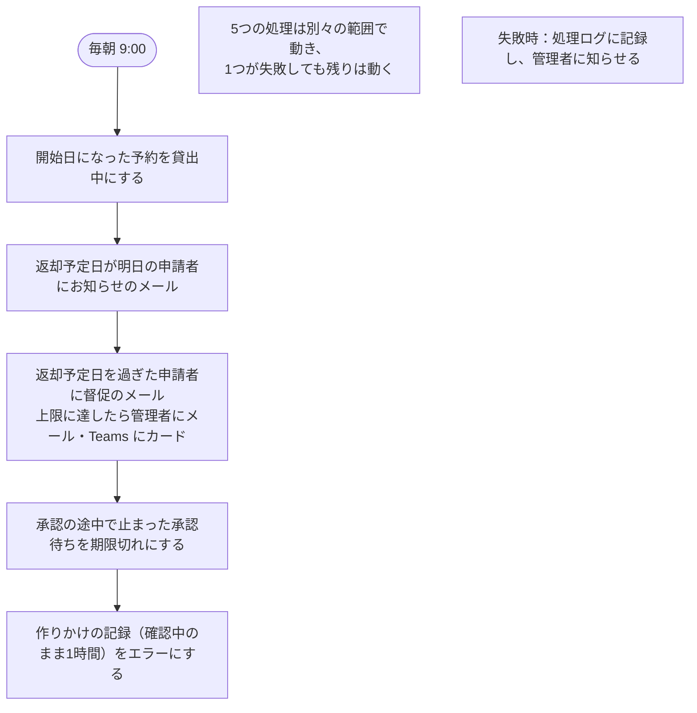

# FLW-003 期限の通知・督促 フロー設計書

## 文書情報

| 項目 | 内容 |
|---|---|
| 文書ID | DD-FLW-003 |
| システム名 | 備品・PC の貸出管理 |
| 版 | 1.0 |
| 作成日 | 2026-11-18 |

## 改版履歴

| 版 | 日付 | 内容 |
|---|---|---|
| 1.0 | 2026-11-18 | `flows/FLW-003.json` から `tools/flow_doc.py` で作成 |

## 1. 概要

| 項目 | 内容 |
|---|---|
| フロー名 | FLW-003 期限の通知・督促 |
| 目的 | 毎朝、開始日を迎えた予約を貸出中にし、返却期限のお知らせ・督促と、止まった記録の後始末をする |
| 関連要件 | REQ-005、REQ-006、REQ-008 |
| トリガー | 毎朝 9:00（日本時間） |
| 同時実行 | 1日1回だけ動く |
| 想定件数 | 1回 数件〜数十件 |
| 手順の数 | 56 |

式・設定の全文は [`flows/FLW-003.json`](../../flows/FLW-003.json)（生成元は `tools/gen_flows.py`）を参照する。

## 2. 全体図

大きな流れだけを示す。条件・分岐・繰り返しの中の手順は、4章のステップ一覧に書く。

## 3. トリガー

| 種類 | 内容 |
|---|---|
| スケジュール | 毎朝 9:00（日本時間） |

## 4. ステップ一覧

- No は実行の順の通し番号。「場所」は、その手順がどの範囲・繰り返し・条件・分岐の中で動くかを表す（空欄はフローの直下）。
- 実行条件は、前の手順が成功したとき以外にも動く手順だけ書く。
- 実行の記録は、氏名・メールアドレス・利用目的などを実行の記録に残さない手順に印を付ける（詳細設計 2.4）。

| No | ステップ | 種類 | 場所 | 実行条件 | 実行の記録 |
|---|---|---|---|---|---|
| 1 | 管理者メール | 変数の初期化 |  |  |  |
| 2 | 今日 | 作成 |  |  |  |
| 3 | 試行 | 範囲 |  |  |  |
| 4 | 設定の取得 | SharePoint に HTTP 要求を送信 | 試行の中 |  |  |
| 5 | 設定の選択 | 選択 | 試行の中 |  |  |
| 6 | 設定 | 作成 | 試行の中 |  |  |
| 7 | 管理者メールの設定 | 変数の設定 | 試行の中 |  |  |
| 8 | 開始日の切り替え | 範囲 | 試行の中 | 管理者メールの設定 が成功・失敗・スキップ・タイムアウトのとき |  |
| 9 | 予約済みの取得 | SharePoint に HTTP 要求を送信 | 開始日の切り替えの中 |  | 入力・出力を隠す |
| 10 | 開始日の記録 | 絞り込み | 開始日の切り替えの中 |  |  |
| 11 | 開始日の記録ごと | 繰り返し | 開始日の切り替えの中 |  |  |
| 12 | 貸出中にする | SharePoint に HTTP 要求を送信 | 開始日の記録ごとの中 |  |  |
| 13 | 開始の予約表 | SharePoint に HTTP 要求を送信 | 開始日の記録ごとの中 |  |  |
| 14 | 開始の予約表をそろえる | 繰り返し | 開始日の記録ごとの中 |  |  |
| 15 | 開始の予約の更新 | SharePoint に HTTP 要求を送信 | 開始の予約表をそろえるの中 |  |  |
| 16 | 前日のお知らせ | 範囲 | 試行の中 | 開始日の切り替え が成功・失敗・スキップ・タイムアウトのとき |  |
| 17 | 貸出中の取得 | SharePoint に HTTP 要求を送信 | 前日のお知らせの中 |  | 入力・出力を隠す |
| 18 | 期限が翌日 | 絞り込み | 前日のお知らせの中 |  |  |
| 19 | 前日のお知らせごと | 繰り返し | 前日のお知らせの中 |  |  |
| 20 | お知らせのメール | メールの送信 | 前日のお知らせごとの中 |  | 入力・出力を隠す |
| 21 | お知らせ済みにする | SharePoint に HTTP 要求を送信 | 前日のお知らせごとの中 |  |  |
| 22 | 督促 | 範囲 | 試行の中 | 前日のお知らせ が成功・失敗・スキップ・タイムアウトのとき |  |
| 23 | 督促対象の取得 | SharePoint に HTTP 要求を送信 | 督促の中 |  | 入力・出力を隠す |
| 24 | 期限切れ | 絞り込み | 督促の中 |  |  |
| 25 | 督促ごと | 繰り返し | 督促の中 |  |  |
| 26 | 督促の回数 | 作成 | 督促ごとの中 |  |  |
| 27 | 督促のメール | メールの送信 | 督促ごとの中 |  | 入力・出力を隠す |
| 28 | 督促を記録 | SharePoint に HTTP 要求を送信 | 督促ごとの中 |  |  |
| 29 | 上限に達した | 条件 | 督促ごとの中 |  |  |
| 30 | 上限を管理者に知らせる | 条件 | 上限に達した：条件が成り立つとき |  |  |
| 31 | 上限の管理者メール | メールの送信 | 上限を管理者に知らせる：条件が成り立つとき |  | 入力・出力を隠す |
| 32 | 上限の通知 | Teams にカードを投稿 | 上限に達した：条件が成り立つとき |  | 入力・出力を隠す |
| 33 | 止まった承認待ちの後始末 | 範囲 | 試行の中 | 督促 が成功・失敗・スキップ・タイムアウトのとき |  |
| 34 | 承認待ちの取得 | SharePoint に HTTP 要求を送信 | 止まった承認待ちの後始末の中 |  | 入力・出力を隠す |
| 35 | 止まった承認待ち | 絞り込み | 止まった承認待ちの後始末の中 |  |  |
| 36 | 止まった承認待ちごと | 繰り返し | 止まった承認待ちの後始末の中 |  |  |
| 37 | 止まった記録を期限切れにする | SharePoint に HTTP 要求を送信 | 止まった承認待ちごとの中 |  |  |
| 38 | 止まったの予約表 | SharePoint に HTTP 要求を送信 | 止まった承認待ちごとの中 |  |  |
| 39 | 止まったの予約表をそろえる | 繰り返し | 止まった承認待ちごとの中 |  |  |
| 40 | 止まったの予約の削除 | SharePoint に HTTP 要求を送信 | 止まったの予約表をそろえるの中 |  |  |
| 41 | 止まった記録のメール | メールの送信 | 止まった承認待ちごとの中 |  | 入力・出力を隠す |
| 42 | 作りかけの後始末 | 範囲 | 試行の中 | 止まった承認待ちの後始末 が成功・失敗・スキップ・タイムアウトのとき |  |
| 43 | 確認中の取得 | SharePoint に HTTP 要求を送信 | 作りかけの後始末の中 |  | 入力・出力を隠す |
| 44 | 作りかけ | 絞り込み | 作りかけの後始末の中 |  |  |
| 45 | 作りかけごと | 繰り返し | 作りかけの後始末の中 |  |  |
| 46 | 作りかけをエラーにする | SharePoint に HTTP 要求を送信 | 作りかけごとの中 |  |  |
| 47 | 作りかけの予約表 | SharePoint に HTTP 要求を送信 | 作りかけごとの中 |  |  |
| 48 | 作りかけの予約表をそろえる | 繰り返し | 作りかけごとの中 |  |  |
| 49 | 作りかけの予約の削除 | SharePoint に HTTP 要求を送信 | 作りかけの予約表をそろえるの中 |  |  |
| 50 | 失敗時 | 範囲 |  | 試行 が成功・失敗・スキップ・タイムアウトのとき |  |
| 51 | 失敗があった | 条件 | 失敗時の中 |  |  |
| 52 | 失敗した手順 | 絞り込み | 失敗があった：条件が成り立つとき |  | 入力を隠す |
| 53 | 失敗の要約 | 選択 | 失敗があった：条件が成り立つとき |  | 入力を隠す |
| 54 | 処理ログに記録 | SharePoint に HTTP 要求を送信 | 失敗があった：条件が成り立つとき | 失敗の要約 が成功・失敗・スキップ・タイムアウトのとき |  |
| 55 | 管理者に知らせる | 条件 | 失敗があった：条件が成り立つとき | 処理ログに記録 が成功・失敗・スキップ・タイムアウトのとき |  |
| 56 | 管理者へのメール | メールの送信 | 管理者に知らせる：条件が成り立つとき |  | 入力・出力を隠す |

## 5. 接続

| 接続 | 使うアカウント | 更新期限 |
|---|---|---|
| Office 365 Outlook | フローの所有者（管理者の1人） | なし（所有者のアカウントが有効な間。異動・退職のときに付け替える） |
| SharePoint | フローの所有者（管理者の1人） | なし（所有者のアカウントが有効な間。異動・退職のときに付け替える） |
| Microsoft Teams | フローの所有者（管理者の1人） | なし（所有者のアカウントが有効な間。異動・退職のときに付け替える） |

## 6. エラー処理・再実行

| 項目 | 内容 |
|---|---|
| エラー時 | 「試行」の中で失敗したら「失敗時」で処理ログに記録し、管理者にメールする |
| 通知先 | 設定「管理者メール」（空ならメールは送らず、処理ログだけ） |
| 再実行の方法 | 詳細画面の「実行」で手動で動かす。同じ日の2回目は最終通知日で送らない |
| 二重実行時の影響 | 同じ日に2回動いても、メール・督促回数は増えない（TC-019） |
