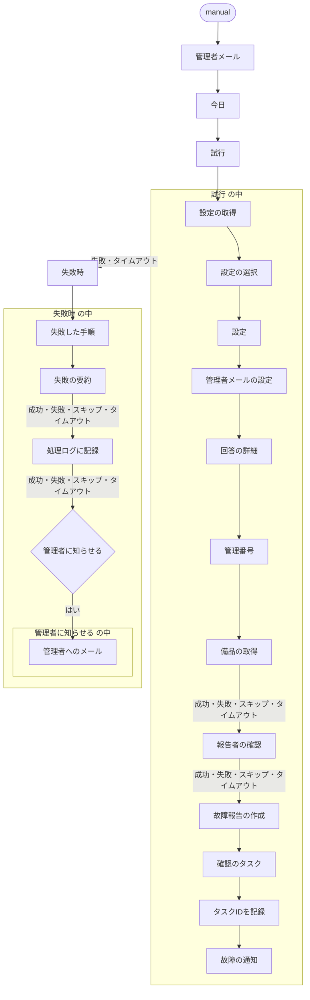

# FLW-004 故障の受付 フロー設計書

## 文書情報

| 項目 | 内容 |
|---|---|
| 文書ID | DD-FLW-004 |
| システム名 | 備品・PC の貸出管理 |
| 版 | 0.1 |
| 作成日 | 2026-11-18 |
| 状態 | 確定 |

## 改版履歴

| 版 | 日付 | 変更内容 | 変更者 |
|---|---|---|---|
| 0.1 | 2026-11-18 | `flows/FLW-004.json` から flow_to_md.py で生成し、概要・接続・エラー処理を記入 | — |

## 1. 概要

| 項目 | 内容 |
|---|---|
| フロー名 | FLW-004 故障の受付 |
| 基盤 | Power Automate |
| 目的 | Forms の故障の報告を故障報告リストに確認待ちで登録し、Planner にタスクを作り、Teams に知らせる |
| 関連要件 | REQ-006、REQ-009 |
| トリガー | Forms「故障・不具合の報告」に回答が送信されたとき |
| 同時実行 | 回答ごとに1回動く。同時に動いても互いに影響しない |
| 想定件数 | 1回 1件。月に数件 |
| ステップ数 | 21 |

## 2. 全体図

## 3. トリガー

| No | 名前 | 種類 | 設定 | 条件・備考 |
|---|---|---|---|---|
| T1 | manual（生成のツールが全フローで同じ名前を付ける） | OpenApiConnectionWebhook | 操作: CreateFormWebhook、form_id={{FORM_ID}} |  |

## 4. ステップ一覧

| No | ステップ名 | 種類 | 前のステップ（実行条件） | 主な設定 | エラー時 | 備考 |
|---|---|---|---|---|---|---|
| 1 | 管理者メール | InitializeVariable |  | variables=[{"name":"管理者メール","type":"string","value":""}] |  |  |
| 2 | 今日 | Compose | 管理者メール | @formatDateTime(convertFromUtc(utcNow(), 'Tokyo Standard Time'), 'yyyy-MM-dd') |  |  |
| 3 | 試行 | Scope | 今日 |  |  |  |
| 3.1 | 　設定の取得 | OpenApiConnection |  | 操作: HttpRequest、dataset={{SITE_URL}}, parameters/method=GET, parameters/uri=_api/web/lists/getbytitle('設定')/items?$select=Title,Setting… |  |  |
| 3.2 | 　設定の選択 | Select | 設定の取得 | from=@body('設定の取得')?['value'], select=@substring(string(setProperty(json('{}'), coalesce(item()?['Title'], ''), coalesc… |  |  |
| 3.3 | 　設定 | Compose | 設定の選択 | @json(concat('{', join(body('設定の選択'), ','), '}')) |  |  |
| 3.4 | 　管理者メールの設定 | SetVariable | 設定 | name=管理者メール, value=@{coalesce(outputs('設定')?['管理者メール'], '')} |  |  |
| 3.5 | 　回答の詳細 | OpenApiConnection | 管理者メールの設定 | 操作: GetFormResponseById、form_id={{FORM_ID}}, response_id=@triggerOutputs()?['body/resourceData/responseId'] |  |  |
| 3.6 | 　管理番号 | Compose | 回答の詳細 | @toUpper(take(trim(coalesce(body('回答の詳細')?['{{Q_CODE}}'], '')), 20)) |  |  |
| 3.7 | 　備品の取得 | OpenApiConnection | 管理番号 | 操作: HttpRequest、dataset={{SITE_URL}}, parameters/method=GET, parameters/uri=_api/web/lists/getbytitle('備品台帳')/items?$select=Id,Title&$f… |  |  |
| 3.8 | 　報告者の確認 | OpenApiConnection | 備品の取得（成功・失敗・スキップ・タイムアウト時） | 操作: HttpRequest、dataset={{SITE_URL}}, parameters/method=POST, parameters/uri=_api/web/ensureuser, parameters/headers={"Accept":"applica… |  |  |
| 3.9 | 　故障報告の作成 | OpenApiConnection | 報告者の確認（成功・失敗・スキップ・タイムアウト時） | 操作: HttpRequest、dataset={{SITE_URL}}, parameters/method=POST, parameters/uri=_api/web/lists/getbytitle('故障報告')/items, parameters/header… |  |  |
| 3.10 | 　確認のタスク | OpenApiConnection | 故障報告の作成 | 操作: CreateTask_V3、body/groupId={{TEAM_ID}}, body/planId={{PLAN_ID}}, body/bucketId={{BUCKET_ID}}, body/title=@{concat('【確認待ち】', outputs('… |  |  |
| 3.11 | 　タスクIDを記録 | OpenApiConnection | 確認のタスク | 操作: HttpRequest、dataset={{SITE_URL}}, parameters/method=POST, parameters/uri=_api/web/lists/getbytitle('故障報告')/items(@{body('故障報告の作成')?… |  |  |
| 3.12 | 　故障の通知 | OpenApiConnection | タスクIDを記録 | 操作: PostCardToConversation、poster=Flow bot, location=Channel, body/recipient/groupId={{TEAM_ID}}, body/recipient/channelId={{CHANNEL_ID}}, body/me… |  |  |
| 4 | 失敗時 | Scope | 試行（失敗・タイムアウト時） |  |  |  |
| 4.1 | 　失敗した手順 | Query |  | from=@result('試行'), where=@equals(item()?['status'], 'Failed') |  |  |
| 4.2 | 　失敗の要約 | Select | 失敗した手順 | from=@body('失敗した手順'), select=@concat(item()?['name'], ':', coalesce(item()?['code'], '')) |  |  |
| 4.3 | 　処理ログに記録 | OpenApiConnection | 失敗の要約（成功・失敗・スキップ・タイムアウト時） | 操作: HttpRequest、dataset={{SITE_URL}}, parameters/method=POST, parameters/uri=_api/web/lists/getbytitle('処理ログ')/items, parameters/header… |  |  |
| 4.4 | 　管理者に知らせる | If | 処理ログに記録（成功・失敗・スキップ・タイムアウト時） | 条件: {"not":{"equals":["@variables('管理者メール')",""]}} |  |  |
| 4.4.Y | 　　【はい の場合】 |  |  |  |  |  |
| 4.4.Y.1 | 　　　管理者へのメール | OpenApiConnection |  | 操作: SendEmailV2、emailMessage/To=@variables('管理者メール'), emailMessage/Subject=【備品貸出】処理に失敗しました（FLW-004 故障の受付）, emailMessage/Body=
FLW-004… |  |  |

## 5. 接続・資格情報

| 接続・資格情報 | 使用アカウント | 使用ステップ | 更新期限 |
|---|---|---|---|
| shared_microsoftforms / shared_microsoftforms | フローの所有者（管理者の1人） | manual、回答の詳細 | なし（所有者のアカウントが有効な間。異動・退職のときに付け替える） |
| shared_sharepointonline / shared_sharepointonline | フローの所有者（管理者の1人） | タスクIDを記録、備品の取得、処理ログに記録、報告者の確認、故障報告の作成、設定の取得 | なし（所有者のアカウントが有効な間。異動・退職のときに付け替える） |
| shared_planner / shared_planner | フローの所有者（管理者の1人） | 確認のタスク | なし（所有者のアカウントが有効な間。異動・退職のときに付け替える） |
| shared_teams / shared_teams | フローの所有者（管理者の1人） | 故障の通知 | なし（所有者のアカウントが有効な間。異動・退職のときに付け替える） |
| shared_office365 / shared_office365 | フローの所有者（管理者の1人） | 管理者へのメール | なし（所有者のアカウントが有効な間。異動・退職のときに付け替える） |

## 6. エラー処理・再実行

| 項目 | 内容 |
|---|---|
| エラー時の分岐 | あり（ステップ一覧の「エラー時」「実行条件」参照） |
| 通知先 | 設定「管理者メール」（空ならメールは送らず、処理ログだけ） |
| 再実行の方法 | 失敗した回答は、処理ログの時刻から Forms の回答を見て、管理者が故障報告リストに手で登録する |
| 二重実行時の影響 | 同じ回答で2回動くと、故障報告とタスクが2件できる（管理者が片方を「対象外」にする） |

## 7. 未決事項

| No | 内容 | 確認先 | 状態 |
|---|---|---|---|
| 1 | なし（実施していない試験は 05 テスト仕様書の3章） | — | — |
