# FLW-005 月次の集計 フロー設計書

## 文書情報

| 項目 | 内容 |
|---|---|
| 文書ID | DD-FLW-005 |
| システム名 | 備品・PC の貸出管理 |
| 版 | 0.1 |
| 作成日 | 2026-11-18 |
| 状態 | 確定 |

## 改版履歴

| 版 | 日付 | 変更内容 | 変更者 |
|---|---|---|---|
| 0.1 | 2026-11-18 | `flows/FLW-005.json` から flow_to_md.py で生成し、概要・接続・エラー処理を記入 | — |

## 1. 概要

| 項目 | 内容 |
|---|---|
| フロー名 | FLW-005 月次の集計 |
| 基盤 | Power Automate |
| 目的 | 前月の貸出件数・延滞・故障を集計し、明細の CSV を月次レポートに保存して管理者に知らせる |
| 関連要件 | REQ-010 |
| トリガー | 毎月1日 9:00（日本時間） |
| 同時実行 | 月に1回だけ動く |
| 想定件数 | 1回 前月の記録の数（数十〜数百件） |
| ステップ数 | 23 |

## 2. 全体図

```mermaid
flowchart TD
    n1(["manual"])
    n2["管理者メール"]
    n3["今日"]
    n4["試行"]
    subgraph gn4["試行 の中"]
        n5["設定の取得"]
        n6["設定の選択"]
        n7["設定"]
        n8["管理者メールの設定"]
        n9["対象の月"]
        n10["前月の貸出"]
        n11["前月の故障"]
        n12["明細"]
        n13["CSV"]
        n14["実際の貸出"]
        n15["延滞あり"]
        n16["ファイルの保存"]
        n17{"集計のメール"}
        subgraph gn17["集計のメール の中"]
            n18["管理者への集計"]
        end
    end
    n19["失敗時"]
    subgraph gn19["失敗時 の中"]
        n20["失敗した手順"]
        n21["失敗の要約"]
        n22["処理ログに記録"]
        n23{"管理者に知らせる"}
        subgraph gn23["管理者に知らせる の中"]
            n24["管理者へのメール"]
        end
    end
    n1 --> n2
    n2 --> n3
    n3 --> n4
    n4 --> n5
    n5 --> n6
    n6 --> n7
    n7 --> n8
    n8 --> n9
    n9 --> n10
    n10 --> n11
    n11 --> n12
    n12 --> n13
    n13 --> n14
    n14 --> n15
    n15 --> n16
    n16 --> n17
    n17 -->|"はい"| n18
    gn4 -->|"失敗・タイムアウト"| n19
    n19 --> n20
    n20 --> n21
    n21 -->|"成功・失敗・スキップ・タイムアウト"| n22
    n22 -->|"成功・失敗・スキップ・タイムアウト"| n23
    n23 -->|"はい"| n24
```

## 3. トリガー

| No | 名前 | 種類 | 設定 | 条件・備考 |
|---|---|---|---|---|
| T1 | manual（生成のツールが全フローで同じ名前を付ける） | Recurrence | frequency=Month, interval=1, timeZone=Tokyo Standard Time, schedule={"monthDays":[1],"hours":["9"],"minutes":[0]} |  |

## 4. ステップ一覧

| No | ステップ名 | 種類 | 前のステップ（実行条件） | 主な設定 | エラー時 | 備考 |
|---|---|---|---|---|---|---|
| 1 | 管理者メール | InitializeVariable |  | variables=[{"name":"管理者メール","type":"string","value":""}] |  |  |
| 2 | 今日 | Compose | 管理者メール | @formatDateTime(convertFromUtc(utcNow(), 'Tokyo Standard Time'), 'yyyy-MM-dd') |  |  |
| 3 | 試行 | Scope | 今日 |  |  |  |
| 3.1 | 　設定の取得 | OpenApiConnection |  | 操作: HttpRequest、dataset={{SITE_URL}}, parameters/method=GET, parameters/uri=_api/web/lists/getbytitle('設定')/items?$select=Title,Setting… |  |  |
| 3.2 | 　設定の選択 | Select | 設定の取得 | from=@body('設定の取得')?['value'], select=@substring(string(setProperty(json('{}'), coalesce(item()?['Title'], ''), coalesc… |  |  |
| 3.3 | 　設定 | Compose | 設定の選択 | @json(concat('{', join(body('設定の選択'), ','), '}')) |  |  |
| 3.4 | 　管理者メールの設定 | SetVariable | 設定 | name=管理者メール, value=@{coalesce(outputs('設定')?['管理者メール'], '')} |  |  |
| 3.5 | 　対象の月 | Compose | 管理者メールの設定 | from=@formatDateTime(addToTime(startOfMonth(convertFromUtc(utcNow(), 'Tokyo Standard Time')), -1, 'Month'), 'yyyy-MM-dd… |  |  |
| 3.6 | 　前月の貸出 | OpenApiConnection | 対象の月 | 操作: HttpRequest、dataset={{SITE_URL}}, parameters/method=GET, parameters/uri=_api/web/lists/getbytitle('貸出記録')/items?$select=Id,LoanStat… |  |  |
| 3.7 | 　前月の故障 | OpenApiConnection | 前月の貸出 | 操作: HttpRequest、dataset={{SITE_URL}}, parameters/method=GET, parameters/uri=_api/web/lists/getbytitle('故障報告')/items?$select=Id&$top=500… |  |  |
| 3.8 | 　明細 | Select | 前月の故障 | from=@body('前月の貸出')?['value'], select={"記録ID":"@item()?['Id']","管理番号":"@if(or(startsWith(coalesce(item()?['Equipment']?… |  |  |
| 3.9 | 　CSV | Table | 明細 | from=@body('明細'), format=CSV |  |  |
| 3.10 | 　実際の貸出 | Query | CSV | from=@body('前月の貸出')?['value'], where=@or(equals(item()?['LoanStatus'], '貸出中'), equals(item()?['LoanStatus'], '返却済み')) |  |  |
| 3.11 | 　延滞あり | Query | 実際の貸出 | from=@body('前月の貸出')?['value'], where=@greater(int(coalesce(item()?['ReminderCount'], 0)), 0) |  |  |
| 3.12 | 　ファイルの保存 | OpenApiConnection | 延滞あり | 操作: CreateFile、dataset={{SITE_URL}}, folderPath=/MonthlyReports, name=@{concat('貸出_', outputs('対象の月')?['label'], '.csv')}, body=@conca… |  |  |
| 3.13 | 　集計のメール | If | ファイルの保存 | 条件: {"not":{"equals":["@variables('管理者メール')",""]}} |  |  |
| 3.13.Y | 　　【はい の場合】 |  |  |  |  |  |
| 3.13.Y.1 | 　　　管理者への集計 | OpenApiConnection |  | 操作: SendEmailV2、emailMessage/To=@variables('管理者メール'), emailMessage/Subject=@{concat('【備品貸出】月次の集計（', outputs('対象の月')?['label'], '）')}, e… |  |  |
| 4 | 失敗時 | Scope | 試行（失敗・タイムアウト時） |  |  |  |
| 4.1 | 　失敗した手順 | Query |  | from=@result('試行'), where=@equals(item()?['status'], 'Failed') |  |  |
| 4.2 | 　失敗の要約 | Select | 失敗した手順 | from=@body('失敗した手順'), select=@concat(item()?['name'], ':', coalesce(item()?['code'], '')) |  |  |
| 4.3 | 　処理ログに記録 | OpenApiConnection | 失敗の要約（成功・失敗・スキップ・タイムアウト時） | 操作: HttpRequest、dataset={{SITE_URL}}, parameters/method=POST, parameters/uri=_api/web/lists/getbytitle('処理ログ')/items, parameters/header… |  |  |
| 4.4 | 　管理者に知らせる | If | 処理ログに記録（成功・失敗・スキップ・タイムアウト時） | 条件: {"not":{"equals":["@variables('管理者メール')",""]}} |  |  |
| 4.4.Y | 　　【はい の場合】 |  |  |  |  |  |
| 4.4.Y.1 | 　　　管理者へのメール | OpenApiConnection |  | 操作: SendEmailV2、emailMessage/To=@variables('管理者メール'), emailMessage/Subject=【備品貸出】処理に失敗しました（FLW-005 月次の集計）, emailMessage/Body=
FLW-005… |  |  |

## 5. 接続・資格情報

| 接続・資格情報 | 使用アカウント | 使用ステップ | 更新期限 |
|---|---|---|---|
| shared_sharepointonline / shared_sharepointonline | フローの所有者（管理者の1人） | ファイルの保存、処理ログに記録、前月の故障、前月の貸出、設定の取得 | なし（所有者のアカウントが有効な間。異動・退職のときに付け替える） |
| shared_office365 / shared_office365 | フローの所有者（管理者の1人） | 管理者へのメール、管理者への集計 | なし（所有者のアカウントが有効な間。異動・退職のときに付け替える） |

## 6. エラー処理・再実行

| 項目 | 内容 |
|---|---|
| エラー時の分岐 | あり（ステップ一覧の「エラー時」「実行条件」参照） |
| 通知先 | 設定「管理者メール」（空ならメールは送らず、処理ログだけ） |
| 再実行の方法 | 詳細画面の「実行」で手動で動かす。同じ月の CSV は上書きされる |
| 二重実行時の影響 | CSV は上書き、メールは2通届く |

## 7. 未決事項

| No | 内容 | 確認先 | 状態 |
|---|---|---|---|
| 1 | なし（実施していない試験は 05 テスト仕様書の3章） | — | — |
