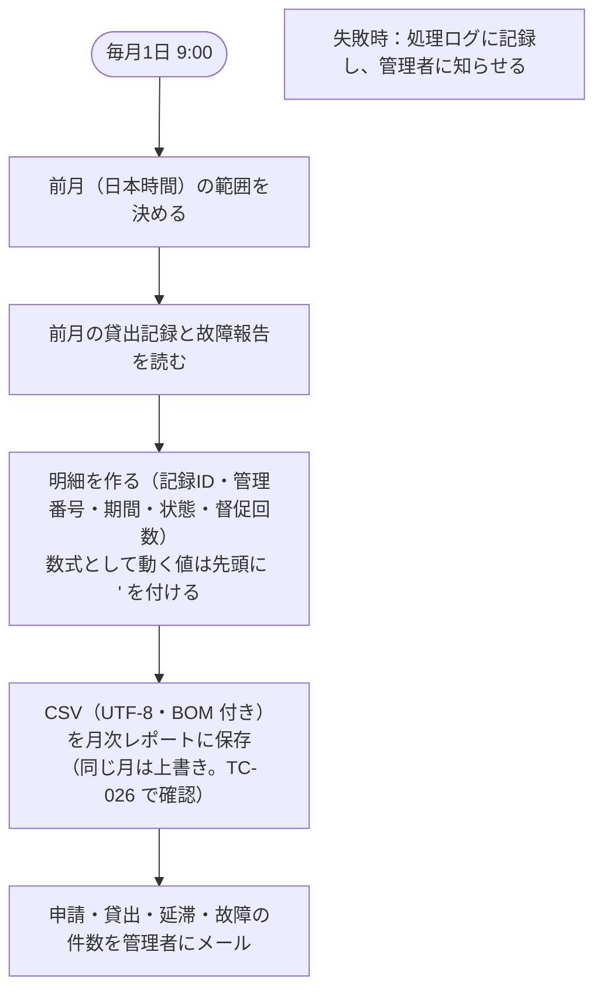

# FLW-005 月次の集計 フロー設計書

## 文書情報

| 項目 | 内容 |
|---|---|
| 文書ID | DD-FLW-005 |
| システム名 | 備品・PC の貸出管理 |
| 版 | 1.0 |
| 作成日 | 2026-11-18 |

## 改版履歴

| 版 | 日付 | 内容 |
|---|---|---|
| 1.0 | 2026-11-18 | `flows/FLW-005.json` から `tools/flow_doc.py` で作成 |

## 1. 概要

| 項目 | 内容 |
|---|---|
| フロー名 | FLW-005 月次の集計 |
| 目的 | 前月の貸出件数・延滞・故障を集計し、明細の CSV を月次レポートに保存して管理者に知らせる |
| 関連要件 | REQ-010 |
| トリガー | 毎月1日 9:00（日本時間） |
| 同時実行 | 月に1回だけ動く |
| 想定件数 | 1回 前月の記録の数（数十〜数百件） |
| 手順の数 | 23 |

式・設定の全文は [`flows/FLW-005.json`](../../flows/FLW-005.json)（生成元は `tools/gen_flows.py`）を参照する。

## 2. 全体図

大きな流れだけを示す。条件・分岐・繰り返しの中の手順は、4章のステップ一覧に書く。

## 3. トリガー

| 種類 | 内容 |
|---|---|
| スケジュール | 毎月1日 9:00（日本時間） |

## 4. ステップ一覧

- No は実行の順の通し番号。「場所」は、その手順がどの範囲・繰り返し・条件・分岐の中で動くかを表す（空欄はフローの直下）。
- 実行条件は、前の手順が成功したとき以外にも動く手順だけ書く。
- 実行の記録は、氏名・メールアドレス・利用目的などを実行の記録に残さない手順に印を付ける（詳細設計 2.4）。

| No | ステップ | 種類 | 場所 | 実行条件 | 実行の記録 |
|---|---|---|---|---|---|
| 1 | 管理者メール | 変数の初期化 |  |  |  |
| 2 | 今日 | 作成 |  |  |  |
| 3 | 試行 | 範囲 |  |  |  |
| 4 | 設定の取得 | SharePoint に HTTP 要求を送信 | 試行の中 |  |  |
| 5 | 設定の選択 | 選択 | 試行の中 |  |  |
| 6 | 設定 | 作成 | 試行の中 |  |  |
| 7 | 管理者メールの設定 | 変数の設定 | 試行の中 |  |  |
| 8 | 対象の月 | 作成 | 試行の中 |  |  |
| 9 | 前月の貸出 | SharePoint に HTTP 要求を送信 | 試行の中 |  | 入力・出力を隠す |
| 10 | 前月の故障 | SharePoint に HTTP 要求を送信 | 試行の中 |  |  |
| 11 | 明細 | 選択 | 試行の中 |  |  |
| 12 | CSV | CSV の表の作成 | 試行の中 |  |  |
| 13 | 実際の貸出 | 絞り込み | 試行の中 |  |  |
| 14 | 延滞あり | 絞り込み | 試行の中 |  |  |
| 15 | ファイルの保存 | SharePoint にファイルを作成 | 試行の中 |  |  |
| 16 | 集計のメール | 条件 | 試行の中 |  |  |
| 17 | 管理者への集計 | メールの送信 | 集計のメール：条件が成り立つとき |  | 入力・出力を隠す |
| 18 | 失敗時 | 範囲 |  | 試行 が失敗・タイムアウトのとき |  |
| 19 | 失敗した手順 | 絞り込み | 失敗時の中 |  | 入力を隠す |
| 20 | 失敗の要約 | 選択 | 失敗時の中 |  | 入力を隠す |
| 21 | 処理ログに記録 | SharePoint に HTTP 要求を送信 | 失敗時の中 | 失敗の要約 が成功・失敗・スキップ・タイムアウトのとき |  |
| 22 | 管理者に知らせる | 条件 | 失敗時の中 | 処理ログに記録 が成功・失敗・スキップ・タイムアウトのとき |  |
| 23 | 管理者へのメール | メールの送信 | 管理者に知らせる：条件が成り立つとき |  | 入力・出力を隠す |

## 5. 接続

| 接続 | 使うアカウント | 更新期限 |
|---|---|---|
| Office 365 Outlook | フローの所有者（管理者の1人） | なし（所有者のアカウントが有効な間。異動・退職のときに付け替える） |
| SharePoint | フローの所有者（管理者の1人） | なし（所有者のアカウントが有効な間。異動・退職のときに付け替える） |

## 6. エラー処理・再実行

| 項目 | 内容 |
|---|---|
| エラー時 | 「試行」の中で失敗したら「失敗時」で処理ログに記録し、管理者にメールする |
| 通知先 | 設定「管理者メール」（空ならメールは送らず、処理ログだけ） |
| 再実行の方法 | 詳細画面の「実行」で手動で動かす。同じ月の CSV は上書きされる |
| 二重実行時の影響 | CSV は上書き、メールは2通届く |
