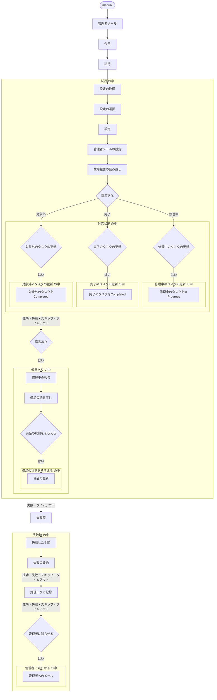

# FLW-006 故障の対応状況の反映 フロー設計書

## 文書情報

| 項目 | 内容 |
|---|---|
| 文書ID | DD-FLW-006 |
| システム名 | 備品・PC の貸出管理 |
| 版 | 0.1 |
| 作成日 | 2026-11-18 |
| 状態 | 確定 |

## 改版履歴

| 版 | 日付 | 変更内容 | 変更者 |
|---|---|---|---|
| 0.1 | 2026-11-18 | `flows/FLW-006.json` から flow_to_md.py で生成し、概要・接続・エラー処理を記入 | — |

## 1. 概要

| 項目 | 内容 |
|---|---|
| フロー名 | FLW-006 故障の対応状況の反映 |
| 基盤 | Power Automate |
| 目的 | 管理者が故障報告の対応状況を変えたら、備品台帳の状態と Planner のタスクをそろえる |
| 関連要件 | REQ-009 |
| トリガー | 故障報告のアイテムが変更されたとき（1分ごとに確認。対応状況が 修理中／完了／対象外 のときだけ） |
| 同時実行 | 備品の状態は修理中の報告の件数で決めるため、どの順で動いても最後は同じ結果になる |
| 想定件数 | 1回 1件。月に数件 |
| ステップ数 | 26 |

## 2. 全体図

## 3. トリガー

| No | 名前 | 種類 | 設定 | 条件・備考 |
|---|---|---|---|---|
| T1 | manual（生成のツールが全フローで同じ名前を付ける） | OpenApiConnection | interval=1, frequency=Minute、操作: GetOnUpdatedItems、dataset={{SITE_URL}}, table={{LIST_FAULTS_ID}} | [{"expression":"@or(equals(triggerBody()?['FaultStatus']?['Value'], '修理中'), equals(triggerBody()?['FaultStatus']?['Valu… |

## 4. ステップ一覧

| No | ステップ名 | 種類 | 前のステップ（実行条件） | 主な設定 | エラー時 | 備考 |
|---|---|---|---|---|---|---|
| 1 | 管理者メール | InitializeVariable |  | variables=[{"name":"管理者メール","type":"string","value":""}] |  |  |
| 2 | 今日 | Compose | 管理者メール | @formatDateTime(convertFromUtc(utcNow(), 'Tokyo Standard Time'), 'yyyy-MM-dd') |  |  |
| 3 | 試行 | Scope | 今日 |  |  |  |
| 3.1 | 　設定の取得 | OpenApiConnection |  | 操作: HttpRequest、dataset={{SITE_URL}}, parameters/method=GET, parameters/uri=_api/web/lists/getbytitle('設定')/items?$select=Title,Setting… |  |  |
| 3.2 | 　設定の選択 | Select | 設定の取得 | from=@body('設定の取得')?['value'], select=@substring(string(setProperty(json('{}'), coalesce(item()?['Title'], ''), coalesc… |  |  |
| 3.3 | 　設定 | Compose | 設定の選択 | @json(concat('{', join(body('設定の選択'), ','), '}')) |  |  |
| 3.4 | 　管理者メールの設定 | SetVariable | 設定 | name=管理者メール, value=@{coalesce(outputs('設定')?['管理者メール'], '')} |  |  |
| 3.5 | 　故障報告の読み直し | OpenApiConnection | 管理者メールの設定 | 操作: HttpRequest、dataset={{SITE_URL}}, parameters/method=GET, parameters/uri=_api/web/lists/getbytitle('故障報告')/items?$select=Id,FaultSta… |  |  |
| 3.6 | 　対応状況 | Switch | 故障報告の読み直し | 値: @first(body('故障報告の読み直し')?['value'])?['FaultStatus'] |  |  |
| 3.6.1 | 　　【ケース 修理中：修理中】 |  |  |  |  |  |
| 3.6.1.1 | 　　　修理中のタスクの更新 | If |  | 条件: {"not":{"equals":["@coalesce(first(body('故障報告の読み直し')?['value'])?['PlannerTaskId'], '')",""]}} |  |  |
| 3.6.1.1.Y | 　　　　【はい の場合】 |  |  |  |  |  |
| 3.6.1.1.Y.1 | 　　　　　修理中のタスクをIn Progress | OpenApiConnection |  | 操作: UpdateTask_V2、id=@first(body('故障報告の読み直し')?['value'])?['PlannerTaskId'], body/percentComplete=In Progress |  |  |
| 3.6.2 | 　　【ケース 完了：完了】 |  |  |  |  |  |
| 3.6.2.1 | 　　　完了のタスクの更新 | If |  | 条件: {"not":{"equals":["@coalesce(first(body('故障報告の読み直し')?['value'])?['PlannerTaskId'], '')",""]}} |  |  |
| 3.6.2.1.Y | 　　　　【はい の場合】 |  |  |  |  |  |
| 3.6.2.1.Y.1 | 　　　　　完了のタスクをCompleted | OpenApiConnection |  | 操作: UpdateTask_V2、id=@first(body('故障報告の読み直し')?['value'])?['PlannerTaskId'], body/percentComplete=Completed |  |  |
| 3.6.3 | 　　【ケース 対象外：対象外】 |  |  |  |  |  |
| 3.6.3.1 | 　　　対象外のタスクの更新 | If |  | 条件: {"not":{"equals":["@coalesce(first(body('故障報告の読み直し')?['value'])?['PlannerTaskId'], '')",""]}} |  |  |
| 3.6.3.1.Y | 　　　　【はい の場合】 |  |  |  |  |  |
| 3.6.3.1.Y.1 | 　　　　　対象外のタスクをCompleted | OpenApiConnection |  | 操作: UpdateTask_V2、id=@first(body('故障報告の読み直し')?['value'])?['PlannerTaskId'], body/percentComplete=Completed |  |  |
| 3.6.D | 　　【既定】 |  |  |  |  |  |
| 3.7 | 　備品あり | If | 対応状況（成功・失敗・スキップ・タイムアウト時） | 条件: {"greater":["@int(coalesce(first(body('故障報告の読み直し')?['value'])?['EquipmentId'], 0))",0]} |  |  |
| 3.7.Y | 　　【はい の場合】 |  |  |  |  |  |
| 3.7.Y.1 | 　　　修理中の報告 | OpenApiConnection |  | 操作: HttpRequest、dataset={{SITE_URL}}, parameters/method=GET, parameters/uri=_api/web/lists/getbytitle('故障報告')/items?$select=Id&$filter=… |  |  |
| 3.7.Y.2 | 　　　備品の読み直し | OpenApiConnection | 修理中の報告 | 操作: HttpRequest、dataset={{SITE_URL}}, parameters/method=GET, parameters/uri=_api/web/lists/getbytitle('備品台帳')/items?$select=Id,EquipSta… |  |  |
| 3.7.Y.3 | 　　　備品の状態をそろえる | If | 備品の読み直し | 条件: {"or":[{"and":[{"greater":["@length(body('修理中の報告')?['value'])",0]},{"equals":["@first(body('備品の読み直し')?['value'])?['Equi… |  |  |
| 3.7.Y.3.Y | 　　　　【はい の場合】 |  |  |  |  |  |
| 3.7.Y.3.Y.1 | 　　　　　備品の更新 | OpenApiConnection |  | 操作: HttpRequest、dataset={{SITE_URL}}, parameters/method=POST, parameters/uri=_api/web/lists/getbytitle('備品台帳')/items(@{first(body('備品の読… |  |  |
| 4 | 失敗時 | Scope | 試行（失敗・タイムアウト時） |  |  |  |
| 4.1 | 　失敗した手順 | Query |  | from=@result('試行'), where=@equals(item()?['status'], 'Failed') |  |  |
| 4.2 | 　失敗の要約 | Select | 失敗した手順 | from=@body('失敗した手順'), select=@concat(item()?['name'], ':', coalesce(item()?['code'], '')) |  |  |
| 4.3 | 　処理ログに記録 | OpenApiConnection | 失敗の要約（成功・失敗・スキップ・タイムアウト時） | 操作: HttpRequest、dataset={{SITE_URL}}, parameters/method=POST, parameters/uri=_api/web/lists/getbytitle('処理ログ')/items, parameters/header… |  |  |
| 4.4 | 　管理者に知らせる | If | 処理ログに記録（成功・失敗・スキップ・タイムアウト時） | 条件: {"not":{"equals":["@variables('管理者メール')",""]}} |  |  |
| 4.4.Y | 　　【はい の場合】 |  |  |  |  |  |
| 4.4.Y.1 | 　　　管理者へのメール | OpenApiConnection |  | 操作: SendEmailV2、emailMessage/To=@variables('管理者メール'), emailMessage/Subject=【備品貸出】処理に失敗しました（FLW-006 故障の対応状況の反映）, emailMessage/Body=
FL… |  |  |

## 5. 接続・資格情報

| 接続・資格情報 | 使用アカウント | 使用ステップ | 更新期限 |
|---|---|---|---|
| shared_sharepointonline / shared_sharepointonline | フローの所有者（管理者の1人） | manual、修理中の報告、備品の更新、備品の読み直し、処理ログに記録、故障報告の読み直し、設定の取得 | なし（所有者のアカウントが有効な間。異動・退職のときに付け替える） |
| shared_planner / shared_planner | フローの所有者（管理者の1人） | 修理中のタスクをIn Progress、完了のタスクをCompleted、対象外のタスクをCompleted | なし（所有者のアカウントが有効な間。異動・退職のときに付け替える） |
| shared_office365 / shared_office365 | フローの所有者（管理者の1人） | 管理者へのメール | なし（所有者のアカウントが有効な間。異動・退職のときに付け替える） |

## 6. エラー処理・再実行

| 項目 | 内容 |
|---|---|
| エラー時の分岐 | あり（ステップ一覧の「エラー時」「実行条件」参照） |
| 通知先 | 設定「管理者メール」（空ならメールは送らず、処理ログだけ） |
| 再実行の方法 | 対応状況をもう一度保存し直す（同じ値でも動く） |
| 二重実行時の影響 | 何度動いても同じ結果になる（TC-024） |

## 7. 未決事項

| No | 内容 | 確認先 | 状態 |
|---|---|---|---|
| 1 | なし（実施していない試験は 05 テスト仕様書の3章） | — | — |
