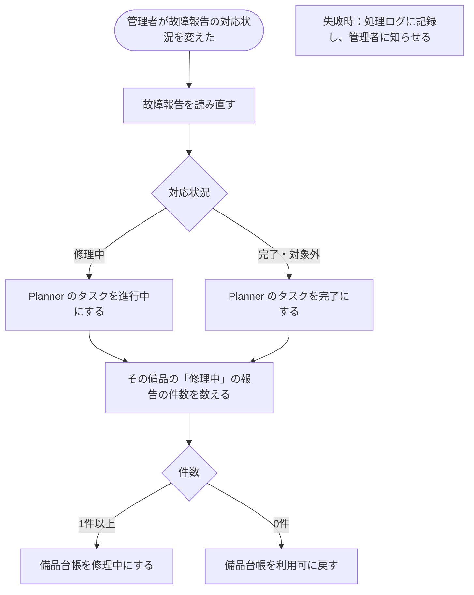

# FLW-006 故障の対応状況の反映 フロー設計書

## 文書情報

| 項目 | 内容 |
|---|---|
| 文書ID | DD-FLW-006 |
| システム名 | 備品・PC の貸出管理 |
| 版 | 1.0 |
| 作成日 | 2026-11-18 |

## 改版履歴

| 版 | 日付 | 内容 |
|---|---|---|
| 1.0 | 2026-11-18 | `flows/FLW-006.json` から `tools/flow_doc.py` で作成 |

## 1. 概要

| 項目 | 内容 |
|---|---|
| フロー名 | FLW-006 故障の対応状況の反映 |
| 目的 | 管理者が故障報告の対応状況を変えたら、備品台帳の状態と Planner のタスクをそろえる |
| 関連要件 | REQ-009 |
| トリガー | 故障報告のアイテムが変更されたとき（1分ごとに確認。対応状況が 修理中／完了／対象外 のときだけ） |
| 同時実行 | 備品の状態は修理中の報告の件数で決めるため、どの順で動いても最後は同じ結果になる |
| 想定件数 | 1回 1件。月に数件 |
| 手順の数 | 26 |

式・設定の全文は [`flows/FLW-006.json`](../../flows/FLW-006.json)（生成元は `tools/gen_flows.py`）を参照する。

## 2. 全体図

大きな流れだけを示す。条件・分岐・繰り返しの中の手順は、4章のステップ一覧に書く。

## 3. トリガー

| 種類 | 内容 |
|---|---|
| SharePoint のアイテムの変更を確認 | 故障報告のアイテムが変更されたとき（1分ごとに確認。対応状況が 修理中／完了／対象外 のときだけ） |

## 4. ステップ一覧

- No は実行の順の通し番号。「場所」は、その手順がどの範囲・繰り返し・条件・分岐の中で動くかを表す（空欄はフローの直下）。
- 実行条件は、前の手順が成功したとき以外にも動く手順だけ書く。
- 実行の記録は、氏名・メールアドレス・利用目的などを実行の記録に残さない手順に印を付ける（詳細設計 2.4）。

| No | ステップ | 種類 | 場所 | 実行条件 | 実行の記録 |
|---|---|---|---|---|---|
| 1 | 管理者メール | 変数の初期化 |  |  |  |
| 2 | 今日 | 作成 |  |  |  |
| 3 | 試行 | 範囲 |  |  |  |
| 4 | 設定の取得 | SharePoint に HTTP 要求を送信 | 試行の中 |  |  |
| 5 | 設定の選択 | 選択 | 試行の中 |  |  |
| 6 | 設定 | 作成 | 試行の中 |  |  |
| 7 | 管理者メールの設定 | 変数の設定 | 試行の中 |  |  |
| 8 | 故障報告の読み直し | SharePoint に HTTP 要求を送信 | 試行の中 |  |  |
| 9 | 対応状況 | 分岐 | 試行の中 |  |  |
| 10 | 修理中のタスクの更新 | 条件 | 対応状況：「修理中」のとき |  |  |
| 11 | 修理中のタスクをIn Progress | Planner のタスクを更新 | 修理中のタスクの更新：条件が成り立つとき |  |  |
| 12 | 完了のタスクの更新 | 条件 | 対応状況：「完了」のとき |  |  |
| 13 | 完了のタスクをCompleted | Planner のタスクを更新 | 完了のタスクの更新：条件が成り立つとき |  |  |
| 14 | 対象外のタスクの更新 | 条件 | 対応状況：「対象外」のとき |  |  |
| 15 | 対象外のタスクをCompleted | Planner のタスクを更新 | 対象外のタスクの更新：条件が成り立つとき |  |  |
| 16 | 備品あり | 条件 | 試行の中 | 対応状況 が成功・失敗・スキップ・タイムアウトのとき |  |
| 17 | 修理中の報告 | SharePoint に HTTP 要求を送信 | 備品あり：条件が成り立つとき |  |  |
| 18 | 備品の読み直し | SharePoint に HTTP 要求を送信 | 備品あり：条件が成り立つとき |  |  |
| 19 | 備品の状態をそろえる | 条件 | 備品あり：条件が成り立つとき |  |  |
| 20 | 備品の更新 | SharePoint に HTTP 要求を送信 | 備品の状態をそろえる：条件が成り立つとき |  |  |
| 21 | 失敗時 | 範囲 |  | 試行 が失敗・タイムアウトのとき |  |
| 22 | 失敗した手順 | 絞り込み | 失敗時の中 |  | 入力を隠す |
| 23 | 失敗の要約 | 選択 | 失敗時の中 |  | 入力を隠す |
| 24 | 処理ログに記録 | SharePoint に HTTP 要求を送信 | 失敗時の中 | 失敗の要約 が成功・失敗・スキップ・タイムアウトのとき |  |
| 25 | 管理者に知らせる | 条件 | 失敗時の中 | 処理ログに記録 が成功・失敗・スキップ・タイムアウトのとき |  |
| 26 | 管理者へのメール | メールの送信 | 管理者に知らせる：条件が成り立つとき |  | 入力・出力を隠す |

## 5. 接続

| 接続 | 使うアカウント | 更新期限 |
|---|---|---|
| Office 365 Outlook | フローの所有者（管理者の1人） | なし（所有者のアカウントが有効な間。異動・退職のときに付け替える） |
| Planner | フローの所有者（管理者の1人） | なし（所有者のアカウントが有効な間。異動・退職のときに付け替える） |
| SharePoint | フローの所有者（管理者の1人） | なし（所有者のアカウントが有効な間。異動・退職のときに付け替える） |

## 6. エラー処理・再実行

| 項目 | 内容 |
|---|---|
| エラー時 | 「試行」の中で失敗したら「失敗時」で処理ログに記録し、管理者にメールする |
| 通知先 | 設定「管理者メール」（空ならメールは送らず、処理ログだけ） |
| 再実行の方法 | 対応状況をもう一度保存し直す（同じ値でも動く） |
| 二重実行時の影響 | 何度動いても同じ結果になる（TC-024） |
